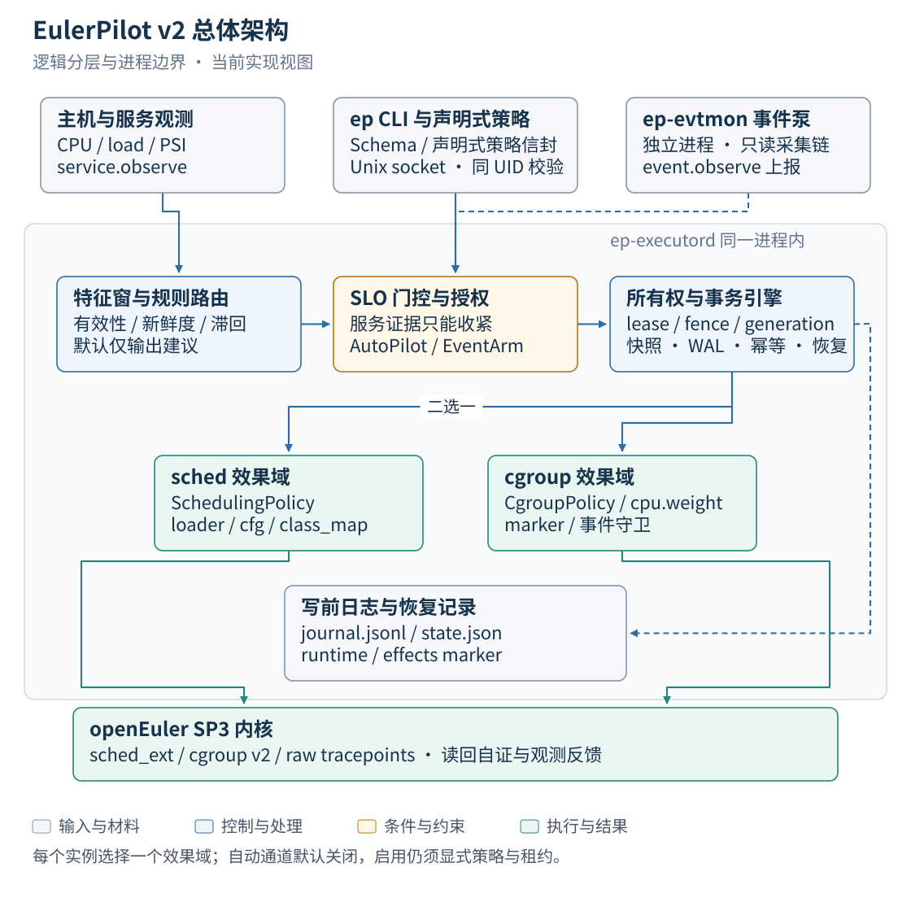

# EulerPilot v2

面向 **2026 年全国大学生计算机系统能力大赛—操作系统设计赛—中西部与华南区域赛—功能挑战赛道**，围绕「面向 openEuler 的自适应资源管控 Agent」重新设计的独立项目。

## 参赛信息

- 高校：西安邮电大学
- 队伍：三驱兄弟
- 队伍 ID：T2026116649912743
- **选题 ID：proj2**
- **题目内容：面向 openEuler 的自适应资源管控 Agent（Adaptive Resource
  Management Agent for openEuler，功能挑战赛道）**——构建可扩展的用户态 Agent，
  感知 workload 特征并按负载动态选择/生成资源策略，重点经由 sched_ext 改善
  CPU 调度，并可扩展 eBPF hook 连接 cgroup 等资源域；交付须在 openEuler
  24.03-LTS-SP3 上正常编译、运行和测试。

**正式文档集**：[项目说明书](docs/项目说明书.md) ·
[设计文档](docs/设计文档.md) · [用户手册](docs/用户手册.md) ·
[部署文档](docs/部署文档.md) · [测试文档](docs/测试文档.md) ·
[参赛文档(大赛大纲)](docs/REPORT.md) ·
[验收判定 R1–R10](docs/ACCEPTANCE_20261025.md) ·
[运行手册(工程版)](docs/MANUAL_SP3.md) ·
[演示视频讲稿](docs/VIDEO_SCRIPT.md)（视频:<百度网盘链接,录制后填写>）

五份正式文档另有同名 `.docx` 交付版（蓝底表头、A4、页码），由
`python scripts/build_docx.py --all` 从 Markdown 重新生成——Markdown 是唯一事实源，
改完 md 重跑该命令即可。

**主验收系统为 openEuler 24.03-LTS-SP3**（SP4 因 cgroup v1/无 PSI 只作可选兼容验证，不替代 SP3 证据）；Ubuntu 用于开发。旧 EulerPilot、SchedPilot 作为参考资产按模块迁移；旧前端验收界面不迁入，以 CLI、结构化状态和可复现实验完成闭环。

## 当前状态（2026-10-25）

方案一句话：**用户态 Agent 负责感知与决策，特权执行服务是唯一写者，v2 自建 sched_ext 数据面执行；所有决策被声明式契约约束，失败时向"无策略"方向回退。** 效果域两个（`sched` 调度实例 / `cgroup` 的 `cpu.weight`），策略 kind 必须与实例的域一致。

| 阶段 | 状态 |
|---|---|
| P0 环境 | 完成（SP3 实机、内核/BTF/config 核验、参考实现干净重建） |
| P1 静态闭环 | **判定达成**（[P1 退出门槛报告](docs/p1/P1_EXIT_REPORT.md)：fail-safe 矩阵 run8 17/17 PASS）。不覆盖：adaptive/心跳/PMU 为 UNSUPPORTED 而非通过；stall 类缺陷未穷尽；崩溃后 pin 靠同实例重启回收。原"越权改 class 不纠正"已于 2026-10-25 由轮换抽样再断言闭合（真机两场景） |
| P2 自适应 | 功能件已实现并单独留证（FeatureWindow/规则路由/SLO 门控/服务观测/切换抑制/自动 apply），自动通道默认关闭；**门控的收益未测出**（只证明是"延迟器不是否决器"，推迟约 40s、代价上界 ≈0–30 个请求），未收口 |
| P3 性能 | 首批正式矩阵已出数（20 block × A0/A1/A2/C/D，seed 20261024，块内配对 + 10000 次 bootstrap）：C vs A0 goodput@5ms **+1.62% [+1.53,+1.82]（20/0）**、p99 −47.9%；C vs A2 **+1.90%**（不是静态权重倾斜）；A1 纯观测臂 **−0.82%**（观测栈是净成本）；BG 相对进度 0.997–1.001。限定：单机单负载单 SLO；@2ms 阈值处无收益；class 路由实测零结果；**新构建后须重跑**（见下一步） |
| P4 扩展 | **R5 两半均已真机闭环**：动作端 cgroup 效果域（cpu.weight,崩溃 marker 恢复）+ 感知端 eBPF 事件链（raw_tp 采集 runnable 等待 → 只读泵 ep-evtmon → event.observe → 武装守卫经事务路径升权/补偿;杀泵门冻结+TTL 兜底）,`integration_events` 为第 8 个 CTest 必测项。见 `evidence/p4/events-link-20261025.txt` |
| P5 交付 | **主体完成**（手册/演示三连彩排/包校验全过/验收报告;镜像打包待比赛形态要求） |

回归基线（最终交付构建 gen-3 `ep-executord 6f667b2e…`）：unit **587** 条断言、`ctest` **8/8**、验收 **r28–r30 各六轮 rc=0**、fail-safe **run9–run11 均 17/17**、演示彩排三连 PASS、`verify_package_sp3.sh` 全过、交付镜像已制作（14.6GiB qcow2,SHA256 见 PROVENANCE）。性能结论指向 gen-1（`3693c9ac…`,矩阵 manifest 在案）：C vs A0 GET **+1.83% [1.38,2.26]（20/0）**、p99 −39.6%;补充对照 B +1.75%、E +1.92%（各 10/0）。总验收判定见 [docs/ACCEPTANCE_20261025.md](docs/ACCEPTANCE_20261025.md)（R1–R10 逐条 + 边界 + 两代构建声明）。

阶段判定依据、逐项证据路径、硬天花板（内核行为与测量能力的边界）与工程约定见 [交接件](docs/HANDOVER_20261024.md)——接手本项目的第一份读物；进度明细见 [实施计划](docs/IMPLEMENTATION_PLAN.md)。

## 从这里阅读

| 文档 | 用途 |
|---|---|
| [完整方案](docs/v2_redesign_2026.md) | 技术路线、架构、算法、故障恢复、创新边界 |
| [交接件（2026-10-24）](docs/HANDOVER_20261024.md) | 方案摘要、当前进度与不覆盖项、硬天花板、下一步优先级、仓库/远端状态、证据索引 |
| [12轮后核验与决策](docs/REVIEW_20261021.md) | 当前缺口、自动apply准入和本轮验证 |
| [实施计划](docs/IMPLEMENTATION_PLAN.md) | 阶段、任务、退出条件和当前进度 |
| [实验协议](docs/EXPERIMENT_PROTOCOL.md) | 公平对照、负载、指标、统计、消融和证据格式 |
| [接口契约](design/INTERFACES.md) | Tool/Skill、调度 ABI、事务和错误处理 |
| [相对原稿的修改](docs/DELTA_FROM_V0_1.md) | 为什么修正 SP3/SP4、默认模式、策略路由等设计 |
| [赛题基准](docs/CONTEST_REQUIREMENTS.md) | 本次用户给出的赛题要求及验收映射 |
| [P0 环境报告](docs/p0/SP3_ENV_REPORT.md) | SP3 实机复验结果、启动参数改动与剩余项 |
| [P1 骨架报告](docs/p1/P1_SKELETON_REPORT.md) | 执行服务/CLI 实现、测试结果、契约偏差与未实现项 |
| [P1 SchedSkill 报告](docs/p1/SCHED_SKILL_REPORT.md) | v2 自建 loader 的真实 attach/detach、崩溃回收与边界 |
| [策略与绑定报告](docs/p1/POLICY_BINDING_REPORT.md) | SchedulingPolicy 校验、cgroup TargetBinding 与实测 |
| [P1 ABI 冻结](docs/p1/ABI_FREEZE.md) | 已实现的 v1alpha1 子集、线路格式、幂等与 reconcile 规则 |
| [P1 退出门槛判定](docs/p1/P1_EXIT_REPORT.md) | 逐项门槛的达成/未达成、证据层级与不证明什么 |
| [来源与资产](PROVENANCE.md) | 旧仓库版本、输入快照、许可和迁移边界 |
| [EulerPilot 审计](docs/audits/eulerpilot_audit.md) / [SchedPilot 审计](docs/audits/schedpilot_audit.md) | 从旧实现和实验中提炼的依据 |
| [外部资料核验](docs/research/sources.md) | 内核、scx、参考论文和证据限制 |

## 现在可执行的检查

设计契约与环境只读探测（不安装依赖、不加载 BPF、不改变调度策略）：

```bash
cd /mnt/d/code/Ubuntu/EulerPilot-v2
python3 scripts/validate_design.py
python3 scripts/doctor.py
```

`validate_design.py` 需要已有的 `jsonschema`；`doctor.py` 仅使用 Python 标准库。`doctor.py --require-scx` 在缺少 sched_ext 能力时返回非零；成功的只读探测仍不等于真实加载测试通过。

SP3 根目录的一键验收（需要已构建、sched_ext idle）：

```bash
bash scripts/accept_sp3.sh /root/epv2-build /root/epv2-src
```

强制 8 个 CTest 必测项无 SKIP（含 `integration_cgroup` 与 `integration_events`：cgroup 域真机闭环与 R5 事件链五相时间线）、A/B/C liveness、产物哈希和收尾状态断言；**不包含性能结论**。多轮驱动用 `scripts/accept_sp3_rounds.sh`。

SP3 协议 §8 fail-safe 矩阵（故障恢复层，17 条目，需要 root、sched_ext idle 且 pin 根为空）：

```bash
bash experiments/fail_safe_matrix_sp3.sh /root/epv2-build/ep-executord /root/epv2-build/ep \
  /root/epv2-build/ep-sched-loader /root/epv2-evidence/fail-safe-$(date +%Y%m%d)
```

它注入的是控制面与内核故障（崩溃、租约/TTL、非法与越界策略、generation 冲突、双实例、外部改值、成员迁出、日志盘满、CPU 热插拔、两步写入的第二步失败），逐条判定"回 default fair 后目标是否继续推进、残余效应是否被内核 map 自证清除"，**不测性能**。2026-10-24 run8 结果 **17/17 PASS、rc=0**（同日 run4 曾以 S14 FAIL 收尾，该缺陷已修复并重验，失败现场保留），见 [fail-safe-20261024.txt](evidence/p1/fail-safe-20261024.txt) §7 与 [P1 退出门槛判定](docs/p1/P1_EXIT_REPORT.md)。

## 设计重点



*图 1　EulerPilot v2 总体架构*

完整 SVG、可编辑 Draw.io 源文件与重建命令见 [图示索引](docs/assets/figures/README.md)，本轮检查结果见 [图示修订记录](docs/FIGURES_20261026.md)。

- SchedPilot 的多队列、唤醒抢占、分类器和实验方法作为起点，先移植静态 C 路径，再验证路由和自适应是否带来增益。
- EulerPilot 的目标解析、Skill、审计与恢复思路保留；控制面重写为轻量 Agent 与唯一特权写入服务。
- 按业务角色与运行特征分别建模；BACKGROUND 来自显式授权，不能凭 CPU 占用猜测。
- SP3 上的真实 sched_ext 闭环是硬门槛；缺能力时只允许标记为降级运行，不算完成赛题核心。
- 以服务 SLO、后台最小进度、静默开销和故障恢复共同约束性能优化。

## 下一步

按优先级（前四项的完成判据见 [交接件](docs/HANDOVER_20261024.md) §5）：

1. ~~R5 后半：eBPF 事件触发链路~~ **已完成（2026-10-25）**：真机六相时间线（空载不动 /
   饥饿升权 / 撤载补偿 / 杀泵门冻结 + TTL 兜底 / 同路径重建 `WATCH_REBUILT` 拒绝 / 泵零
   写入），泵开销已量化（0.5% 单核、12.1k 事件/s、丢弃 0）。
2. ~~在冻结构建上重跑 A1/C/D 矩阵臂~~ **已完成（2026-10-25）**：gen-1 复现 C vs A0 GET
   **+1.83% [1.38,2.26]（20/0）**，与首轮 +1.62% 同向并列报告，负结果（A1 成本、@2ms
   无优势）一并保留。
3. ~~class 逐条漂移的处置~~ 已完成（2026-10-25,抽样再断言,真机两场景）。
4. ~~R6 对照臂~~ B 臂与 E 臂已完成（2026-10-25）：B vs A0 **+1.75%**（收益在 BASIC 形态就出现,class 额外贡献≈0）;E vs A0 GET **+1.92% [0.94,2.17]**、SET 打平（新旧控制面同量级）。X 臂：SP3 上无上游 scx 二进制,判 UNSUPPORTED。
5. ~~P5 交付~~ 完成（2026-10-25）：手册 [docs/MANUAL_SP3.md](docs/MANUAL_SP3.md)、演示
   三连彩排、包校验全过、[验收报告](docs/ACCEPTANCE_20261025.md)、交付镜像
   `schedpilot-sp3-20261025.qcow2`（14.6GiB）。
6. **事件链在旗舰口径下的收益量化**：目前只测了泵开销，未测自动升权对 goodput 的贡献；
   需在饿死场景加一条 F 臂并按同口径配对。
7. **负载泛化**：性能结论目前限定单机 + Redis 单负载 + 单 SLO；新增计算密集与混合负载
   轮次需独立预注册。
8. **map 饱和场景**：BPF 聚合 map 上限 4096 个 cgroup，未构造饱和故障，补矩阵条目后如实
   标注 PASS/SKIP。
9. **交付物形态**：镜像 14.6GiB 的提交方式待组委会确认；演示视频待录制（讲稿已就绪）。

## 许可

本项目采用 **GPL-2.0**（2026-10-21 决定），全文见 [LICENSE](LICENSE)。组件级边界见 [NOTICE](NOTICE)：
`sched/` 为 SchedPilot 派生的 GPL-2.0 组件，`third_party/nlohmann` 为 MIT，旧 EulerPilot 仅作参考。
