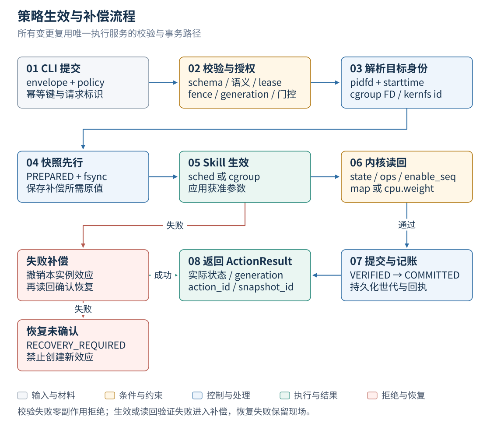
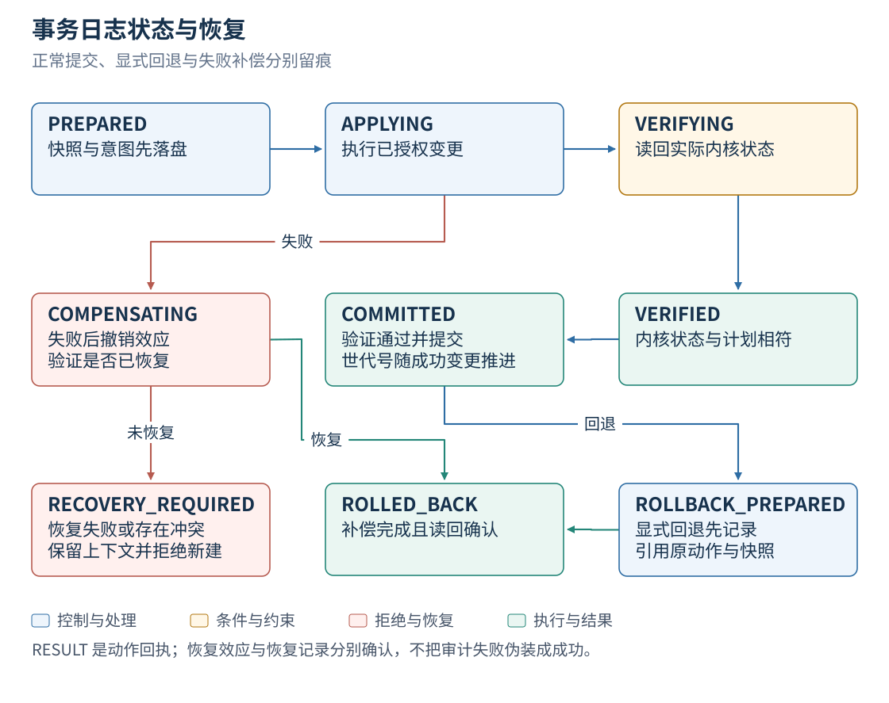

# Tool / Skill / 策略接口契约

版本 `eulerpilot.io/v1alpha1`。本目录是设计契约。控制面骨架、真实 sched_ext Skill
(FD 传递生产路径)、cgroup 动作域与事件链均已实现并在 SP3 上验证;实现边界、线路包装
和新增字段以 `docs/p1/ABI_FREEZE.md` 为准,逐条判定见 `docs/ACCEPTANCE_20261025.md`。
JSON Schema采用Draft-07，JSON文件也可被YAML解析器读取；初版以JSON为规范交换格式，CLI将来可接受YAML并先转为规范JSON。

## 1. 领域对象

| 对象 | 职责 | 生命周期 |
|---|---|---|
| TargetRef | 用户意图中的cgroup/PID范围和业务角色 | 解析为TargetBinding后才能执行 |
| TargetBinding | boot_id、namespace、pidfd/starttime或cgroup FD/id、授权子树 | 退出/重建/迁出立即失效 |
| FeatureWindow | 对齐窗口、身份、指标值/单位/有效性/来源/age | 到期不得用于决策 |
| SchedulingPolicy | 白名单专家、实例级参数、目标角色和安全约束 | Schema+语义校验后生成计划 |
| CgroupPolicy | cgroup v2 效果声明（当前仅 `cpu.weight`）、TTL 与安全约束 | Schema+语义校验；写入的域必须与执行服务 `--skill` 一致 |
| PolicyPlan | 已解析身份、前置条件、差异、snapshot与补偿顺序 | 发布前再次校验 |
| ActionEnvelope | 请求/幂等/所有权/generation/deadline与策略摘要 | 唯一执行服务处理 |
| ActionResult | 实际状态、生效版本、验证/恢复结果 | 持久可追溯 |
| SkillManifest | 能力、schema、作用域和权限 | 静态加载，版本匹配 |
| EventObservation | ep-evtmon 只读泵的一个窗口：per-cgroup runnable 等待（events/wait_max/wait_avg）+ 泵健康计数 | 过期即拒,不取租约,只能让门更严 |
| EventArm | R5 自主事件动作的人工授权：watch 路径、阈值、持续/回落窗数、动作 cpu_weight、TTL | arm 属主必须持租约;条件清除或 TTL 到期逆序补偿 |

BG来自TargetRef显式角色；行为推断不修改角色授权。TargetRef路径仍须防符号链接和越权，schema正则不能替代文件描述符与内核身份验证。

## 2. Tool协议



*图 1　策略生效与补偿流程*

已实现 11 个 op：`policy.status`、`feature.snapshot`、`route.decide`、`slo.evaluate`、
`service.observe`、`event.observe`、`lease.acquire`、`policy.validate`、`policy.apply`、
`policy.rollback`、`transaction.reconcile`。只读操作与写操作在权限模型上区分，所有写操作
复用相同执行通道。`skill.list/describe/probe` 与 `schedule.plan` 仍属计划项，执行服务未
注册这两个 op；Skill 能力由 `SkillManifest` 静态声明。MCP是可选适配器，并非本契约必需。

写操作请求把信封字段嵌套在 `envelope` 下，与 `policy`（或测试模式的 `intent`）并列：
`apiVersion`、`request_id`、`transaction_id`、`idempotency_key`、`operation`、
`policy_sha256`、`lease_owner`、`fence_epoch`、`expected_generation`、`issued_at`、
`deadline`（线路格式见 `docs/p1/ABI_FREEZE.md`）。策略摘要由规范序列化生成，同时保存原始
文件SHA256；二者明确区分，不能拿文本哈希冒充语义等价。`deadline` 必须晚于 `issued_at`
（语义校验，schema 不表达）。

结果固定包含：

```json
{
  "request_id": "req-example-001",
  "status": "VERIFIED",
  "observed_generation": 8,
  "policy_sha256": "<64 lowercase hex>",
  "target_bindings": [],
  "checks": [],
  "rollback": {"attempted": false, "status": "NOT_NEEDED"},
  "error": null
}
```

状态集合：`PLANNED / APPLIED / VERIFIED / REJECTED / ROLLED_BACK / DEGRADED / RECOVERY_REQUIRED`，只读成功另返回 `OK`；`PLANNED`/`APPLIED` 属领域定义，当前实现不产出（生效即 `VERIFIED`）。错误码全集：`NONE / SCHEMA_INVALID / UNSUPPORTED / PERMISSION_DENIED / TARGET_STALE / OWNERSHIP_CONFLICT / GENERATION_CONFLICT / DEADLINE_EXCEEDED / SLO_DENIED / APPLY_FAILED / VERIFY_FAILED / ROLLBACK_FAILED / RECOVERY_REQUIRED / IDEMPOTENCY_CONFLICT / INTERNAL`。只有真实验证通过才返回VERIFIED；恢复失败不能返回ROLLED_BACK。

相同幂等键、相同规范请求返回原结果；相同键不同内容拒绝。generation不匹配不自动重试覆盖；Agent重新获取状态并生成计划。

`policy.rollback`必须有`rollback_of`，明确原apply_action_id、original_transaction_id和snapshot_id；不可仅以同一策略摘要选择快照。执行服务从不可变日志取得该次动作的TargetBinding，重新检查当前实例身份、所有权和generation。样例见`examples/rollback-action.json`。

## 3. Skill生命周期

```cpp
struct Skill {
  virtual ProbeResult probe(const CapabilityContext&) = 0;
  virtual PlanResult plan(const ValidatedIntent&, const TargetBinding&) = 0;
  virtual SnapshotResult snapshot(const Plan&) = 0;
  virtual ApplyResult apply(const Plan&, const Snapshot&, const Lease&) = 0;
  virtual VerifyResult verify(const AppliedAction&, Deadline) = 0;
  virtual RecoveryResult rollback(const AppliedAction&, const Snapshot&) = 0;
  virtual RecoveryResult reconcile(const JournalRecord&) = 0;
  virtual void stop() noexcept = 0;
  virtual ~Skill() = default;
};
```

接口为概念示意；实际类型/异常边界由实现定义。每个Skill报告effect_scope（task/cgroup/scheduler-instance/netns/interface）、required_capabilities、是否可补偿、哪些效果不可逆。所有特权apply/rollback均在执行服务内；Agent侧只有纯plan逻辑。

`sched_ext`必需；`cgroup`用于最小扩展；`event_hook`用于真实eBPF感知触发；`network/security`分阶段加入。BPF LSM/XDP不因有manifest就算已实现。

## 4. 策略DSL

文件：`schemas/scheduling-policy.schema.json`，样例 `examples/redis-policy.json`。

- `spec.scope`固定为`scheduler-instance`：初版参数共享，不能对不同cgroup伪造独立全局slice。
- `targets`显式声明前台/后台/中立角色；执行时解析出身份和权限，不把样例路径当本机已存在。
- `expert`为白名单profile；`parameters`为有界值，mode与生成来源存档。
- `safety`包含最小驻留、最大观测年龄、心跳、策略TTL、quiet预算和后台进度底线。`evaluation_min_bg_progress_ratio`是配对实验中相对同场景A0工作率的评估门槛，在线Agent不把它当可观测反事实。在线保护使用明确工作单位的`min_bg_work_units_per_sec`与`bg_progress_window_ms`、以及`max_bg_wait_ms`；绝对门槛来自pilot冻结配置。`max_foreground_p99_ms`（可选）是前向延迟的在线绝对上限：实测p99的相邻窗抖动为3.8–20%，比策略声明的5%相对预算粗，所以在线判前向退化只能用绝对量（协议§5.1）。
- 策略未声明改cpuset/affinity，纯调度实验不得暗改它们；此类动作未来用独立cgroup策略和对照。

schema保证字段类型/枚举/静态范围。语义校验进一步检查slice关系、TTL/驻留/心跳、目标重复、策略能力条件。真正执行仍需kernel probe、授权、身份、资源冲突、当前generation和目标健康检查。当前脚本通过不代表策略可安全部署。

## 5. 调度ABI与发布

目标共享头包含magic、abi_version、struct_size、capability_bits、owner/fencing、generation、mode、参数、lease期限；各字段宽度/对齐使用编译期断言和测试。启动拒绝不匹配，不猜字段布局。

class记录将业务角色、行为、置信度、身份cookie、expires_ns和generation分开。v1迁移可以先沿用旧ABI做参考臂，生产v2必须显式升级，不能悄悄复用旧pin路径。

路径规划：`/sys/fs/bpf/eulerpilot-v2/<instance>/`，启动获取运行锁并读取所有权；路径字符串不等于所有权。执行服务持有map/link FD，控制map不向普通CLI暴露写权限。停止时只释放自己创建且仍属于本实例的对象。

配置发布需要验证map-in-map/版本bank在所选SP3内核上的支持与RCU语义。BPF在回调开头取得一致快照，旧bank/旧队列在安全退出前不得复用；若无法实现所需一致性，初版限制为单配置结构的小范围更新并明确其保证边界，不宣称跨map原子。

## 6. 控制事务状态



*图 2　事务日志状态与恢复*

`PREPARED(snapshot+intent fsync) → APPLYING → VERIFYING → COMMITTED`；失败进入`COMPENSATING → ROLLED_BACK`或`RECOVERY_REQUIRED`。每步带实例身份、原值/新值、控制generation、外部改动检测和可重复恢复规则。

重启先reconcile未完成记录，不继续新计划。补偿只恢复仍由本项目控制的值；外部修改或目标重建必须报告冲突，不能覆盖。恢复旧资源值不能撤销已经发生的OOM/丢包/拒绝调用。

## 7. 当前设计检查的边界

`scripts/validate_design.py`校验三个schema、正样例和负样例，包括BG角色、范围、驻留/TTL及所有权字段。`scripts/doctor.py`只读输出能力线索。schema尚未冻结为稳定API，后续修改需要同步示例/契约/校验，并给出版本迁移说明。
