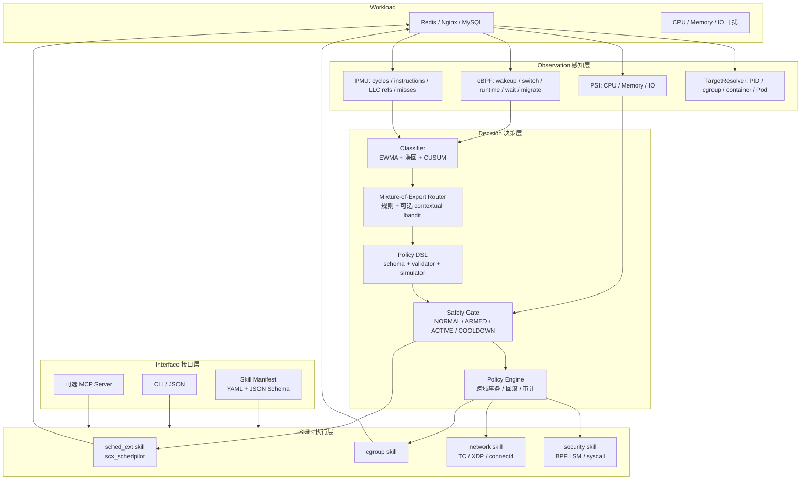

# EulerPilot v2 重构方案

> 面向 **2026 年全国大学生计算机系统能力大赛 · 操作系统设计赛 · 中西部与华南区域赛 · 功能挑战赛道**
> 赛题：面向 openEuler 的自适应资源管控 Agent（Adaptive Resource Management Agent for openEuler）
> 文档状态：设计稿 v0.1 · 2026-10-19
>
> **交付环境说明**：赛题文案写 SP3；技术上 SP3 发行内核不含/未启用 sched_ext，需要启用 OLK 分支、回合补丁并编译；SP4 才是完整支持环境。v2 按「SP4 主环境 + SP3 兼容」设计，并建议向组委会确认文案是否已更新。

---

## 0. 结论：不是合并，是重做一版 v2

旧的两个项目各有明确的“半边”：

- **EulerPilot**：Agent 框架、多域 Skill、Policy Engine、审计/回滚、Web Console、证据体系；但 sched_ext 数据面是原型，性能实测平庸甚至负收益。
- **SchedPilot**：sched_ext 数据面、分类器、PMU、自适应策略、严格实验方法；但它是单机调度 daemon，没有 Agent 框架、没有多域扩展、没有标准化 Skill 接口。

新赛题的要求比旧赛题更“系统能力”导向：

1. 交付环境文案是 **openEuler 24.03-LTS-SP3**，但 SP3 发行内核不含/未启用 sched_ext；**SP4 才是完整支持环境**（赛题文案很可能未更新）。
2. 明确要求 **标准化的 Tool / Skills 能力接口**。
3. 明确要求 Agent **“动态选择或生成资源管理策略”**，不只是分类后选一个固定策略。
4. 演示评分强调 **完整性、流畅度与可验证性**。
5. 参考资料直接点名 **Agentic OS（LLM Agent Framework）** 与 **Mixture-of-Schedulers（Learned Router）**。

因此，正确的做法不是把两个仓库拼起来，而是：

> **以 SchedPilot 的调度数据面和实验方法为“引擎”，以 EulerPilot 的多域 Skill 思想为“扩展层”，重写一个面向 openEuler 24.03 LTS（SP4 主环境）的新 v2：以 Mixture-of-Expert-Schedulers + 安全门控 + 标准化 Skill 接口为核心。**

旧代码只作为“可复用的零件”和“对照基线”，不作为必须沿用的架构。

---

## 1. 新赛题 vs 旧赛题：六个必须改变的地方

| 维度 | 旧赛题（第三届研究生 OS 大赛） | 新赛题（2026 系统能力大赛） | v2 的应对 |
|---|---|---|---|
| 交付环境 | SP4 主验证，SP3 强制兼容 | **文案写 SP3，实际 sched_ext 完整支持在 SP4** | **SP4 主环境**（性能/演示）+ **SP3 代码兼容** + 定制 SP3 内核；向组委会确认文案 |
| 关键词 | “调整 CPU 调度策略” | **“动态选择或生成策略”** | 增加 Policy DSL + Mixture-of-Expert 路由器 |
| 接口要求 | Skills 框架 | **标准化的 Tool / Skills 接口** | Manifest + JSON Schema + CLI + 可选 MCP |
| 演示要求 | 流畅、有说服力 | **完整、流畅、可验证** | `make demo` + `make verify` + PASS/FAIL 断言 + 证据包 |
| 参考资料 | 同样列了 Agentic OS / MoS | 更强调 **LLM Agent + Learned Router** | 确定性核心 + 可选 LLM 策略顾问 + 可学习路由器 |
| 评委画像 | 研究生赛，偏工程完整度 | 系统能力大赛，偏内核/BPF/实验严谨性 | 深度优先：sched_ext 做深，扩展做“证明”不做“堆量” |

### 1.1 最重要的判断：旧 EulerPilot 的调度部分要“降级为背景”

旧 EulerPilot 的 `scx_eulerpilot` 实测（RUNS=10，vs noisy_default）：

| 模式 | Redis GET | Redis INCR | Redis SET | Nginx |
|---|---:|---:|---:|---:|
| `scx_normal`（单 shared DSQ） | +3.4% | +17.0% | −6.2% | −0.1% |
| `scx_always_active`（类 DSQ） | **−62.6%** | +4.2% | −2.0% | **−19.8%** |
| quiet 基础开销 | **−25.9%**（Redis） | — | — | −6.1% |

这不是“提升幅度一般”，而是“类路由模式崩盘、静默开销很大”。**v2 不应沿用 `scx_eulerpilot` 作为生产数据面**，最多保留它作为实验中的 reference arm，用来证明“换引擎之后确实变好了”。

---

## 2. 战略：三条主线 + 一个原则

### 2.1 三条主线

1. **性能主线（25 分）**
   - 以 `scx_schedpilot` 的数据面为核心：5 类、LAT/COMP/CACHE/BG、per-LLC CACHE DSQ、抢占、vtime 惩罚、3 模式。
   - 在 **SP4 主环境**重跑 A/B/C/D + 消融 + 配对统计；SP3 做兼容验证与 cgroup 对照。
   - 目标：Redis/Nginx 相对默认 fair 调度器有明确正向收益，quiet 开销 < 5%。

2. **智能主线（30 分）**
   - **Mixture-of-Expert-Schedulers**：不是“一个调度器”，而是一组专家策略 + 一个路由器。
   - **安全门控**：默认 BASIC，压力上升才升级到 CLASS/ADAPTIVE。
   - **Policy DSL / 策略生成**：Agent 能“生成”一份可验证的调度策略，而不只是选预设。
   - 可选：LLM 策略顾问（只提议，不直接写内核）。

3. **扩展主线（25 分中的“功能完整性”）**
   - cgroup / network / security 作为 Skill 扩展证明，复用 EulerPilot 的 eBPF 资产。
   - 做一个“跨域事务”演示：security anomaly → sched BG + cgroup 限流 + TC 限速，一个 transaction_id，失败整体回滚。
   - 不做“每个方向都半成品”，而是“调度很深 + 扩展可验证”。

### 2.2 一个原则：LLM/学习组件只提议，确定性组件做决策

> **LLM/bandit 可以提出候选策略；schema validator、边界检查、离线模拟器、安全门控和事务回滚负责“批不批”。**

这条原则同时解决三个问题：

- 评委对“LLM 直接改内核”的安全质疑；
- 演示时网络/模型不可用的风险；
- 策略生成的可复现性（生成的 DSL 可以存档、回放、对比）。

---

## 3. 目标架构



### 3.1 双环路

- **100ms 调度快环**：采样 → 分类 → 路由 → 写 `sp_cfg` / `class_map` → 心跳。
- **1s 治理环**：Policy Engine、Skill 生命周期、跨域事务、审计、证据。
- 两个环路解耦，避免把调度决策绑在 1s 上。

### 3.2 单一写者

- Agent 是 `sp_cfg` / `class_map` 的唯一写者。
- `schedpilotd` 只作为 **Expert Mode** 对照，不参与生产。
- 启动时检查 owner/generation，避免双写。

### 3.3 双层 fail-open

- Agent 崩溃 → BPF 2s 心跳超时 → 静态安全参数，调度器不离场。
- loader 崩溃 → sched_ext 自动 detach → 默认 fair 接管。
- Skill 失败 → 事务回滚 + ActionJournal。

---

## 4. 六个核心设计

### 4.1 Mixture-of-Expert-Schedulers（创新 30 分的核心）

**问题**：现在的 sched_ext 调度器通常是“一个固定策略 + 一组静态参数”。换 workload、换压力，就要人工调参。

**方案**：把调度策略拆成一组 **专家策略（expert policies）**，由 Agent 在线路由。

- 专家策略库（示例）：
  - `latency-strict`：LAT 1ms、抢占 0.3ms、BG 1ms。
  - `latency-balanced`：LAT 1ms、抢占 0.5ms、BG 2ms。
  - `throughput`：COMP 4ms、CACHE 8ms、BG 4ms。
  - `cache-local`：CACHE 8ms、LLC 亲和、迁移惩罚 4ms。
  - `safe-default`：BASIC，单 shared DSQ。
- 路由器输入：workload 类别、置信度、PSI、run delay、迁移率、历史收益。
- 路由器输出：专家策略 ID + 有界参数覆盖。
- **规则 + 学习**：
  - 第一版：规则表（可解释、可审计、零训练）。
  - 第二版：每个类别维护一个小型 contextual bandit（UCB/Thompson），在 4–6 个专家策略中选择；reward = SLA 满足率 − CPU 成本 − 切换惩罚。
  - 安全约束：切换有最小间隔；收益连续下降则回退到规则策略；bandit 只能在白名单策略中选择。
- **为什么这是创新**：它直接对应参考资料里的 "Mixture-of-Schedulers: An Adaptive Scheduling Agent as a Learned Router for Expert Policies"；不是“调参”，而是“策略组合 + 在线路由”。

**实验**：
- 固定 C / 固定 D / Router（规则）/ Router（bandit）四组对比。
- 指标：QPS、p99、goodput@SLO、策略切换次数、收敛时间。
- 如果 bandit 没有稳定超过规则版，就如实报告“规则路由已足够”，不要硬吹学习。

### 4.2 Safety-Gated Escalation（安全门控）

- `NORMAL / COOLDOWN` → `BASIC`：单 shared DSQ，接近默认调度。
- `ARMED` → `CLASS`：类 DSQ + 静态专家策略。
- `ACTIVE` → `ADAPTIVE`：类 DSQ + 路由/自适应参数。
- 进入 ACTIVE 的条件：PSI 高 + run delay 高 + 存在可管理的干扰任务；退出条件带滞回和冷却。
- 所有参数有上下界、速率限制、generation；Agent 崩溃自动回退。

**为什么重要**：旧 EulerPilot 的 `always_active` 是 −62.6%，说明“一上来就类路由”是危险的。v2 的默认必须是 BASIC，只有压力上升才升级。这是对历史失败的直接修正，也是答辩最好讲的创新点之一。

### 4.3 Policy DSL + 策略生成（对应“生成策略”）

**问题**：赛题要求 Agent 能“动态选择或**生成**资源管理策略”。只做分类 + 选预设，不够。

**方案**：定义一个声明式调度策略 DSL。

```yaml
apiVersion: eulerpilot.io/v1
kind: SchedulingPolicy
metadata:
  name: redis-latency-slo
spec:
  target:
    kind: cgroup
    path: /sys/fs/cgroup/eulerpilot/redis
  classes:
    latency:
      dsq: LAT
      slice_ns: 1000000
      preempt_thresh_ns: 500000
      vtime_pct: 100
    background:
      dsq: COMP
      vtime_pct: 200
      slice_ns: 2000000
  mode: adaptive
  constraints:
    max_switch_interval_s: 5
    max_slice_ns: 2000000
```

- **生成方式**：
  1. 规则生成：从 workload 特征 + SLO 模板生成。
  2. LLM 生成（可选）：自然语言意图 → DSL；LLM 只输出 DSL，不接触内核。
  3. 离线搜索：用历史 trace 做小规模参数搜索，生成候选策略。
- **验证**：
  - JSON Schema 校验；
  - 边界/安全校验；
  - 离线 trace replay / 小规模仿真；
  - 通过后才 apply；失败自动回滚。
- **证据**：生成的 DSL、校验结果、apply 前后对比，全部存档。

这是“Agent 生成策略”的最务实实现：**生成的是可审计的声明式策略，不是任意 BPF 代码**。

### 4.4 标准化 Tool / Skills 接口（赛题硬性要求）

**Manifest**：

```yaml
apiVersion: eulerpilot.io/v1
kind: Skill
metadata:
  name: sched_ext
  version: 1.0.0
  description: sched_ext scheduling skill
spec:
  capabilities: [probe, apply, status, rollback]
  configSchema: schemas/sched_ext.schema.json
  actions:
    - name: set_mode
      params: { mode: { enum: [basic, class, adaptive] } }
    - name: apply_policy
      params: { policy: { type: object } }
  safety:
    bounded: true
    rollback: true
    requiresRoot: true
```

**C++ 接口**：

```cpp
class Skill {
public:
    virtual ~Skill() = default;
    virtual ProbeResult probe() = 0;
    virtual Status init(const SkillConfig &cfg) = 0;
    virtual Status apply(const Action &action) = 0;
    virtual Snapshot snapshot() const = 0;
    virtual Status rollback() = 0;
    virtual void stop() = 0;
};
```

**CLI**：

```bash
eulerpilot skill list --json
eulerpilot skill describe sched_ext --json
eulerpilot skill probe sched_ext --json
eulerpilot skill apply sched_ext --action set_mode --param mode=adaptive --json
eulerpilot skill status --json
eulerpilot skill rollback sched_ext --json
```

**可选 MCP**：把 Skill 暴露为 MCP tools，让 LLM Agent 可以调用；但 MCP 只是“外壳”，真正执行仍走同一套 Skill 接口和校验。

### 4.5 跨域事务（扩展方向的“杀手锏”）

场景：security skill 检测到异常进程（如 burst_execve / burst_connect）。

```text
security anomaly
  -> policy engine (transaction_id)
  -> sched_ext: 把目标标为 BG / 降权
  -> cgroup: CPU/Memory/IO 限流
  -> network: TC 限速 / XDP drop
  -> 验证
  -> 失败则整体回滚
```

纯调度器做不到这一点；这是“OS Agent”区别于“sched_ext 调度器”的核心证据。

**实现建议**：复用 EulerPilot 的 `PolicyEngine` / `ActionJournal` 思路，但重写为更小的模块；只做 1–2 条链路，不追求全量。

### 4.6 可验证演示（演示 10 分）

**一键演示**：

```bash
make demo          # 启动 Redis + 干扰 + Agent + dashboard
make demo-sched    # 只演示 sched_ext 闭环
make demo-cross    # 跨域事务
make verify        # 非交互式验收，输出 PASS/FAIL + 证据包
```

**演示脚本的 7 个断言**：

1. `sched_ext` 已加载，mode=BASIC。
2. Agent 把 Redis 分类为 LAT、干扰分类为 BG。
3. PSI 上升，Gate 从 NORMAL → ARMED → ACTIVE，mode 从 BASIC → CLASS → ADAPTIVE。
4. 相对默认调度器，QPS 提升 ≥ 阈值，p99 改善 ≥ 阈值（现场实测，不是回放）。
5. `kill -9` Agent：sched_ext 不离场，心跳超时后静态兜底，QPS 波动在阈值内。
6. `kill` loader：sched_ext detach，默认 fair 接管，workload 不中断。
7. `eulerpilot skill rollback`：参数恢复，状态回到 BASIC。

每一步输出 `[PASS]`/`[FAIL]`，并写入 `evidence/demo-<timestamp>.json`。**评委可以自己跑 `make verify` 复核**，这就是“可验证性”。

---

## 5. 资产处置：保留、重写、丢弃

| 资产 | 处理 | 原因 |
|---|---|---|
| `scx_schedpilot` BPF 数据面 | **保留并改名/重构** | v2 的性能核心；5 类、抢占、LLC、vtime 已验证 |
| SchedPilot 分类器 / PMU / CUSUM | **保留，模块化** | 感知层的核心；单测可复用 |
| SchedPilot A/B/C/D 实验框架 | **保留，适配 SP4 主环境 + SP3 兼容** | 配对统计、消融、fail-fast 是稀缺资产 |
| SchedPilot `schedpilotd` | **降级为 Expert Mode** | 只做对照，不参与生产；避免双控制面 |
| SchedPilot 的“C 模式是甜点”结论 | **保留为设计依据** | C 模式 +167%，D 只多 ~2pp；先做 C 再做 D |
| EulerPilot Skill 框架 | **重写，简化** | 旧框架能跑，但和调度耦合太深；v2 要真正标准化 |
| EulerPilot Policy Engine / 事务 / 审计 | **重写，保留思想** | 跨域事务是扩展亮点；旧实现太重 |
| EulerPilot Web Console | **重写或简化** | 演示要稳；CLI/TUI 优先，Web 可选 |
| EulerPilot network/security eBPF | **保留为扩展 Skill** | 复用代码，但只做 1–2 条可验证链路 |
| EulerPilot `scx_eulerpilot` | **只作为 reference arm** | 实测 −62.6%（类路由）/ +3.4%（shared），不能做生产 |
| EulerPilot 42 条 evidence / 29 门禁 | **简化** | 新赛题不需要那么重的官僚体系；保留“冻结 + 哈希 + 可复现” |
| EulerPilot SP4 主叙事 | **保留并重写** | SP4 才是 sched_ext 完整支持环境；改成「SP4 主环境 + SP3 兼容」叙事 |
| EulerPilot 1s 主环 / 4 类模型 | **替换** | v2 用 100ms 快环 + 5 类 + PMU |
| EulerPilot 文档/PPT | **重写** | 新赛题、新评委、新故事 |

---

## 6. SP3/SP4 交付策略：赛题文案与内核现实的落差

### 6.1 事实与判断

- **SP3 发行内核**（如 `6.6.0-132.0.0.111.oe2403sp3`）不包含/未启用 sched_ext；要跑 sched_ext，需要启用 OLK 分支、回合 6.12 的 sched_ext 补丁，并打开 `CONFIG_SCHED_CLASS_EXT=y`、`CONFIG_EXT_GROUP_SCHED=y` 重新编译。
- **SP4 是完整支持环境**：团队已在 SP4 上完成自编译 sched_ext 内核验证（EulerPilot 的 `6.6.0-159...eulerpilot-scx`、SchedPilot 的 `6.6.0-schedpilot`），调度、观测、性能实验都跑通了。
- **新赛题文案写 SP3，很可能是旧赛题未更新**：旧赛题写于 SP4 发布前；新赛题的题目、评分、参考资料几乎照搬，交付环境这一行大概率没改。
- **但评委可能按字面用 SP3 环境**，所以不能只赌“组委会会改”。v2 必须做到「SP4 跑出性能、SP3 跑通代码、两者都能演示」。

### 6.2 四层交付

| 层 | 环境 | 能做什么 | 交付物 |
|---|---|---|---|
| L0 stock SP3 | 发行内核 | 编译、单测、cgroup 模式、eBPF 观测、Skill CLI、跨域事务（cgroup/network/security） | `make test` / `make demo` 必须通过；sched_ext 不可用自动降级 |
| L1 custom SP3 kernel | 启用 OLK 分支 + sched_ext 配置后自编译 | sched_ext 全功能、SP3 兼容性验证 | `scripts/kernel/build_sp3.sh` + RPM + SHA256 + 安装说明 |
| L2 **SP4 主环境** | SP4 + 自编译/已启用 sched_ext 内核 | **性能矩阵、A/B/C/D、演示** | `scripts/kernel/build_sp4.sh` + 内核 RPM + 证据 |
| L3 预装 VM | SP4 自定义内核镜像/快照 | 评委一键复现；现场演示 | qcow2/ova + 启动脚本 + 账号说明 |

### 6.3 关键动作

1. **向组委会确认（最重要）**：给蔡朝晖老师（`zhcai@whu.edu.cn`）发邮件，问清楚：
   - 交付环境是否仍要求 SP3，还是已更新为 SP4；
   - 如果要求 SP3，是否接受「启用 OLK 分支 + 自编译内核」的方式；
   - 评审环境是否允许携带自定义内核 / VM。
   - 邮件附上技术事实：SP3 发行内核不含 sched_ext；SP4 才是完整支持；我们两种环境都能交付。
2. `eulerpilot doctor` 输出能力矩阵：内核版本、`/sys/kernel/sched_ext`、BTF、PMU、cgroup v2、BPF LSM、TC/XDP。
3. stock SP3 上 sched_ext 不可用时，Agent **不报错退出**，而是降级到 cgroup 后端，并在 dashboard 明确显示 `sched_ext=unavailable (kernel)`。
4. README 第一页写清：
   - stock SP3 能跑什么；
   - sched_ext 需要什么内核（SP4，或 SP3 + OLK 合并）；
   - 如何用 3 条命令构建/安装内核；
   - 性能数字是在哪个内核上测的。
5. 性能主表放 SP4；SP3 只放「兼容性 + 功能 smoke + cgroup 性能」，不要把两套数字混在一张表里。
6. 如果比赛允许，提供一个预装内核的 VM 镜像，是最稳的「可复现」方案。

---

## 7. 新代码结构（建议新仓库）

```text
eulerpilot/
  README.md
  DESIGN.md
  Makefile                 # make build/test/demo/verify/evidence
  CMakeLists.txt
  agent/
    core/                  # runtime, event loop, config, logging, errors
    observe/               # eBPF loader, PMU sampler, PSI reader, target resolver
    classify/              # EWMA + hysteresis + CUSUM
    route/                 # Mixture-of-Expert router (rules + optional bandit)
    gate/                  # PSI safety gate
    policy/                # Policy DSL, validator, simulator, engine, transactions
    skills/
      sched_ext/           # writes sp_cfg/class_map, heartbeat, stats
      cgroup/              # CPU/Memory/IO, target resolver, rollback
      network/             # TC/XDP/connect4
      security/            # BPF LSM/syscall
    api/                   # CLI, JSON, optional MCP
  sched/
    bpf/                   # scx_schedpilot.bpf.c, intf.h
    loader/                # scx_schedpilot.c
  bpf/                     # observation + extension hooks
  schemas/                 # skill / policy JSON schemas
  configs/                 # YAML manifests, scenarios
  bench/                   # workloads, interference, A/B/C/D harness
  tests/                   # unit, integration, fault injection, soak
  scripts/                 # env_check, build, kernel, demo, evidence
  web/                     # optional dashboard
  docs/                    # design, report, runbook, Q&A
  evidence/                # frozen artifacts, manifests, hashes
```

**工程约束**：

- C++20，CMake；`-Wall -Wextra -Werror`（或分级）。
- clang-format + clang-tidy；CI 跑 format/build/test。
- 每个 Skill 一个目录 + 一个 manifest + 一组单测。
- 所有内核交互通过 RAII 封装；失败路径必须有 rollback。
- 不在热路径做字符串/文件 IO；日志异步。
- 所有实验脚本 `set -euo pipefail`；输出 JSON + CSV。

---

## 8. 实验方案（SP4 主环境重跑，SP3 兼容验证，不直接引用旧数字）

### 8.1 环境

- **SP4 主环境**（sched_ext 完整支持）：openEuler 24.03-LTS-SP4，8 vCPU / 16 GiB（或物理机 8 核）；SP3 作为兼容验证环境。
- server `0-3`、client `4-7`、interference `0-3`。
- 自定义内核 `6.6.0-eulerpilot-sp4`（主环境）/ `6.6.0-eulerpilot-sp3`（兼容验证），均启用 `CONFIG_SCHED_CLASS_EXT=y`。
- 固定 CPU governor、关闭 turbo（如可）、固定 NUMA。

### 8.2 负载与干扰

- Redis：`redis-benchmark` GET/INCR/SET，p50/p99/p999/goodput@SLO。
- Nginx：`wrk`，QPS/p99。
- MySQL：`sysbench`，TPS/p99（可选，基线敏感需披露）。
- 干扰：CPU 4 workers + 内存 2 workers × 1G + 可选 IO。
- 场景：quiet、noisy、phase-change（压力上升/下降）。

### 8.3 实验臂

| 臂 | 说明 |
|---|---|
| A | 默认 fair 调度器 |
| B | basic sched_ext（单 shared DSQ） |
| C | class sched_ext（分类 + 静态专家策略） |
| D-agent | Agent 原生分类 + 路由 + 自适应 |
| D-expert | `schedpilotd` 专家对照 |
| D-no-pmu / no-llc / no-bg / no-router | 消融 |
| R | 旧 `scx_eulerpilot` reference |

### 8.4 统计

- 逐轮配对 `mean Δ%` + 95% CI + 更高/更低轮数。
- n=20 × 60s（旗舰 Redis/Nginx）；MySQL n=10。
- 交错轮转、fail-fast、无效轮次 `INVALID`。
- 保留负结果（quiet 回归、MySQL 基线漂移、Nginx 双峰）。

### 8.5 证据

- `tested_code_commit` + 内核版本 + 二进制 SHA256 + 配置 + 场景 JSON。
- `evidence/formal-<date>/` 原始数据 + `summary.md` + `per_run.csv`。
- `make evidence` 生成 `manifest.json`，`make verify` 校验完整性。

---

## 9. 演示方案（10 分）

### 9.1 现场 5 分钟

1. **0:00–0:30**：`eulerpilot doctor` 展示能力矩阵；`skill list` 展示标准化接口。
2. **0:30–1:30**：`make demo` 启动 Redis + 干扰；dashboard 显示 baseline（默认调度器）。
3. **1:30–2:30**：Agent 识别 LAT/BG，Gate 升级，QPS/p99 实时改善；切换 BASIC/CLASS/ADAPTIVE 看差异。
4. **2:30–3:30**：故障注入：kill Agent → 静态兜底；kill loader → fair 接管；rollback。
5. **3:30–4:30**：跨域事务：security anomaly → sched BG + cgroup 限流 + TC 限速，transaction_id 串起来，失败回滚。
6. **4:30–5:00**：`make verify` 输出 PASS/FAIL + 证据包，展示“可验证性”。

### 9.2 可验证性设计

- 每个断言都有明确的阈值和原始计数器。
- 演示结束后生成 `evidence/demo-*.json`，包含：
  - 环境指纹（内核、CPU、内存）；
  - 每步的 before/after 指标；
  - PASS/FAIL；
  - 二进制/配置哈希。
- 评委可以拿 U 盘拷走证据包，或自己跑 `make verify`。

---

## 10. 需求—实现—证据映射（写进 README/报告）

| 赛题要求 | 实现 | 演示步骤 | 证据 |
|---|---|---|---|
| 可扩展 Agent 框架 + 标准化 Tool/Skills | `agent/core` + `skills/*` + manifest + CLI | `skill list/describe/apply` | `evidence/skills.json` |
| workload 感知 + CPU 调度调整 | `observe` + `classify` + `route` + `sched_ext` | dashboard 分类/模式变化 | `evidence/trace.jsonl` |
| sched_ext 闭环 + 性能验证 | `sched_ext` skill + `bench/` | A/B 切换 + `make verify` | `evidence/formal-*/` |
| eBPF 扩展 network/security/resource | `skills/network`、`security`、`cgroup` | 跨域事务 | `evidence/transaction.json` |
| 完整性能数据 + 可复现环境 | `bench/` + `scripts/env_check` + `make evidence` | `make verify` | `evidence/manifest.json` |

这张表直接回应“可验证性”，也是答辩时最省时间的材料。

---

## 11. 分阶段计划

> 假设 8–10 周。若截止更近，按“最小可交付”裁剪。

| 阶段 | 周 | 目标 | 退出标准 |
|---|---|---|---|
| P0 | W1 | SP4/SP3 双环境验证：SP4 sched_ext + SP3 stock 降级；SchedPilot 数据面加载；仓库骨架；Skill 接口 | `make test` 在 stock SP3 通过；`scx_schedpilot --status` 在 SP4 sched_ext 内核通过 |
| P1 | W2–W3 | Agent 核心 + sched_ext Skill C 模式；分类器；CLI；基础 dashboard | A/B/C 三臂跑通；C > A 正向；rollback 通过 |
| P2 | W4–W5 | D 模式：PMU、5 类、路由、Gate、自适应；消融 | D-agent ≈ D-expert（CI 内）；Gate 状态迁移可观测 |
| P3 | W6–W7 | **SP4 性能矩阵**：Redis/Nginx（+MySQL）；配对统计；证据冻结；SP3 兼容 smoke | n=20，0 无效轮次；quiet 开销 <5%；证据完整 |
| P4 | W8 | 跨域事务 + 扩展 Skill；标准化接口完善 | 1 条跨域链路可演示、可回滚 |
| P5 | W9–W10 | 文档、PPT、视频、`make verify`、彩排 | 3 次彩排通过；证据包可复现 |

### 最小可交付（4–5 周）

`P0 + P1 + P3（只跑 Redis）+ P5（简化文档/演示）`。

性能故事：C 模式在 **SP4** 上相对默认调度器 +X%（目标 ≥ +50%），quiet 开销 <5%，Agent 崩溃/loader 崩溃 fail-open 可演示；SP3 侧保证构建/单测/cgroup 降级。即使不做 D/路由/跨域，也能满足赛题五条要求的基本盘。

---

## 12. 风险与规避

| 风险 | 影响 | 规避 |
|---|---|---|
| 赛题写 SP3、实际 sched_ext 在 SP4 | 评委按字面用 SP3，跑不起 sched_ext | ①向组委会确认 SP3/SP4；②SP4 主环境 + SP3 代码兼容 + 定制 SP3 内核；③`doctor` 能力矩阵；④预装 VM |
| 自编译内核门槛高 | 评委不愿装 | 预装 VM 镜像 + 一键脚本 + RPM + 3 步说明 |
| 性能数字与旧项目不一致 | 被质疑 | 统一环境重跑；旧数字只作 reference；报告注明口径 |
| Router/bandit 不稳定 | 性能抖动 | 规则路由兜底；bandit 只在白名单策略中选；切换有间隔/回退 |
| LLM 不可用/不可复现 | 演示翻车 | LLM 只做可选顾问；确定性 DSL 生成器兜底；离线缓存 |
| 范围过大 | 做不完 | 深度优先：sched_ext 做深；network/security 只做 1–2 条链路 |
| 双控制面冲突 | 抖动/不可解释 | Agent 单一写者；Expert Mode 互斥 |
| 旧代码债务 | 越改越乱 | 新仓库 + 只移植经过验证的模块；旧仓库归档 |
| 竞赛合规（复用旧作品） | 资格问题 | 在 README/报告写清 provenance；确认新赛题规则；必要时向组委会说明 |

---

## 13. 决策清单

1. **仓库策略**：新仓库 `eulerpilot`（推荐，干净历史），还是在 EulerPilot 上开 v2 分支？
2. **截止时间**：什么时候提交/答辩？决定 4 周最小版还是 8–10 周完整版。
3. **内核交付**：只给脚本，还是 RPM + VM 镜像都提供？（推荐后者）
4. **LLM 范围**：只做 Policy DSL + 规则生成，还是加一个可选的本地 LLM 顾问？
5. **负载范围**：Redis + Nginx，还是加 MySQL？
6. **扩展深度**：network/security 各做一条链路，还是只做 cgroup + security？
7. **品牌**：继续叫 EulerPilot，还是换一个新名字（避免和旧作品混淆）？
8. **团队**：几个人、多少时间/周？决定并行度。

---

## 14. 第一周动作（P0）

- [ ] 给蔡朝晖老师（`zhcai@whu.edu.cn`）发确认邮件：SP3 还是 SP4、是否接受 OLK 合并的自编译内核、评审环境是否允许带 VM。
- [ ] 在 SP4 上固化 sched_ext 证据：`ls /sys/kernel/sched_ext`、`grep CONFIG_SCHED_CLASS_EXT /boot/config-$(uname -r)`、`scx_schedpilot --status`。
- [ ] 在 stock SP3 上跑：`make`、`make test`、`eulerpilot doctor`，确认 cgroup/eBPF 降级路径可用。
- [ ] 用 SP3 源码 + OLK 分支回合构建 `CONFIG_SCHED_CLASS_EXT=y` 内核；确认 `/sys/kernel/sched_ext`。
- [ ] 在 SP4 sched_ext 内核上加载 `scx_schedpilot`，跑 `--status`、A/B/C 小规模。
- [ ] 搭新仓库骨架：`agent/`、`sched/`、`bench/`、`schemas/`、`scripts/`；定义 `Skill` 接口和 manifest。
- [ ] 冻结实验环境：CPU governor、干扰参数、Redis/Nginx 配置、RUNS/DURATION。
- [ ] 写一页 `README` 能力矩阵：stock SP3 / custom SP3 / SP4 各能跑什么。
- [ ] 团队评审本设计，砍掉不做的部分。

---

## 附录 A：v2 的一句话定位

> **EulerPilot v2 是一个面向 openEuler 24.03 LTS 的 Agentic OS 调度控制面（SP4 主环境、SP3 兼容）：它把 sched_ext 调度器拆成一组可组合的专家策略，用带安全门控的 Mixture-of-Experts 路由器按 workload 特征在线选择策略，用声明式 Policy DSL 支持策略生成与校验，并用标准化 Skill 接口把 cgroup、network、security 纳入同一事务化控制面；它在 Redis/Nginx 混布场景相对默认 fair 调度器取得可复现的配对性能提升，同时保证 Agent/loader 崩溃时的 fail-open。**

## 附录 B：不建议做的事

- 不要把旧 EulerPilot 的 42 条 evidence / 29 门禁原样搬过来。
- 不要把 network/security 做成和 sched_ext 同等深度。
- 不要假设 stock SP3 能跑 sched_ext，也不要把 SP4 的自编译内核要求藏起来。
- 不要让 LLM 直接写 `sp_cfg` / BPF / cgroup。
- 不要在没有统一环境重跑的情况下引用旧项目的 +181%。
- 不要保留两个控制面同时写同一张 BPF map。
- 不要为了“功能多”而牺牲“调度深”。
