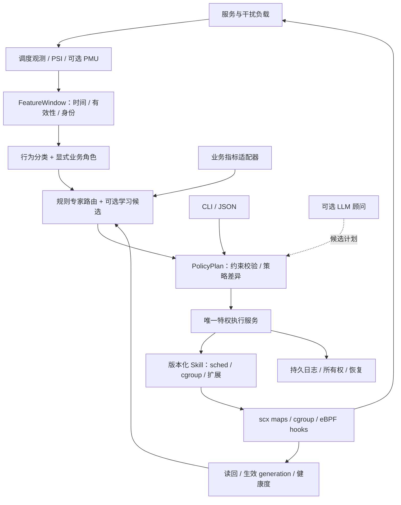

# EulerPilot v2 完整设计方案

版本：v0.2；日期：2026-10-21；状态：设计已建立，运行闭环待实现。

面向本次新赛题重新建项目。输入为旧 `EulerPilot/docs/v2_redesign_2026.md`、两个项目源码/证据，以及获准查阅的“开源创新”会话。原稿保存于 `reference/`；输入指纹见根目录 `PROVENANCE.md`。本文件取代原稿作为 v2 的实施依据。

## 1. 项目定位与已经作出的取舍

**目标：在 openEuler 24.03-LTS-SP3 上构建可扩展用户态资源管控 Agent，优先把 sched_ext 性能、可靠恢复和可复现实验做扎实。**

采用 SchedPilot 的数据面与实验经验，借鉴 EulerPilot 的 Skill、目标解析和审计恢复机制，重新定义控制面。不要求兼容旧配置，不复制旧发布包，不迁移旧 Web 验收界面。CLI 的状态、理由、动作与证据应足够完成现场展示。后续若有余力，薄 TUI 只消费同一状态 API。

本次交付是方案与可校验接口，不是已完成的调度系统。所有性能百分比、超时、采样周期和预算，除明确标为历史证据外，都属于待校准的设计初值或验收目标。

| 优先级 | 内容 | 原因 |
|---|---|---|
| 最高 | SP3 真实内核/ABI 验证、最小 A/B/C | 环境正确、静态策略有效后才值得扩展 |
| 高 | Agent→Skill→执行服务→scx→反馈、规则路由 | 满足感知和自适应闭环 |
| 高 | 静默回归、后台进度、故障恢复 | 防止靠压死后台换取漂亮前台数据 |
| 中 | cgroup + 一个真实 eBPF 扩展链路 | 证明 Agent 框架可扩展 |
| 可选 | 学习路由、LLM 顾问、更多网络/安全能力 | 必须在核心验收以后，不能挤占正式实验 |

## 2. 证据对设计的约束

### 2.1 旧结果能说明什么

EulerPilot 旧正式报告中的 Redis GET：`scx_normal` 吞吐配对约 +3.40%，95% CI 跨零；`scx_always_active` 约 −62.62%。该报告GET的p99“改善”−37.75%实际表示延迟变差，不能误写为p99下降。这证明旧类队列路径在那套环境中有明显退化，不能直接作为 v2 基础；尚不能单凭这个结果断定全部根因是分类器、DSQ 或某一个旋钮。见 `audits/eulerpilot_audit.md`。

SchedPilot `formal-4` 中 C 与 D 的收益接近，`formal-5` 记录 D 相对 A 约 +181.5%。后者只有 A/D 正式对照，不能用它推导“最终 D 明显胜过最终 C”。手工指定 BG、不同调度优先级、虚拟机 PMU/LLC 退化和双峰基线，均须在新实验中披露。见 `audits/schedpilot_audit.md`。

两者内核、时间、构建与场景不同，不能把旧百分比相减当作新系统提升。v2 报告只引用统一环境、冻结构建上重跑的数据。

### 2.2 原稿需要修正的关键前提

- **SP3 是主交付系统。** 不能推测赛题写错，也不能以 SP4 成功及 SP3 的 cgroup 降级替代 sched_ext 验收。
- 本地 SchedPilot 留有 SP3 自定义内核构建与小样本运行记录，提示应先检查对应 SP3 源码已有实现/配置，而非预设必须从 Linux 6.12 回移。历史记录不等于本轮实机复验。
- BASIC 是另一种 BPF 调度器，不等于默认 fair，也不保证低开销。quiet 策略必须由实测决定是否保持加载或退回 fair。
- LAT/COMPUTE/CACHE 是行为特征，BG 是业务角色；拆为两个维度，不称作对称的“五类自动识别”。
- 专家路由、LLM 建议、PSI 滞回已有相关工作。项目的改进假设在约束、发布一致性和实测闭环，不能因换名字声称原创。

## 3. 交付环境与内核路线

### 3.1 验收矩阵

| 环境 | 用途 | 判定 |
|---|---|---|
| SP3 + 已核验支持 scx 的内核 | **主构建、主集成、主性能、主演示** | 必须通过，内核来源/补丁/配置/哈希完整 |
| SP3 发行默认内核 | 能力检测、用户态测试、允许的扩展 | scx 若不可用必须 UNSUPPORTED；不算 R3/R4 完成 |
| Ubuntu 22.04 开发环境 | 契约检查、离线单元、工具开发 | 本机 WSL 无 scx 时不运行内核实验 |
| SP4 或支持 scx 的其他发行版 | 可选兼容/泛化 | 不能代替 SP3 主证据 |

主线先复核 SchedPilot 的 `6.6.0-schedpilot-sp3` 构建配方与准确源码版本。依次检查：对应源码是否已有 `kernel/sched/ext.c` 和 Kconfig；配置依赖；发行二进制是否启用；启动内核与 BTF 是否匹配；目标 kfunc/struct_ops 是否存在。仅当实现确实缺失，才评估发行分支补丁/回移成本。

禁止以“版本号 ≥6.12”或一个 sysfs 目录断言兼容；上游首次合入版本与发行回移是两件事。CO-RE 不能消除 sched_ext kfunc/struct_ops 的演进差异。初版固定一个 SP3 内核源提交、BTF、libbpf 与 BPF 构建适配层；后续逐项验证新版本。

### 3.2 P0 必须形成的环境证据

`os-release`、`uname`、内核 config/源码提交/补丁清单、BTF/内核镜像/RPM 哈希、编译器、libbpf、bpftool、CPU/SMT/NUMA/LLC、PMU 事件实测、cgroup v2/PSI、调度器 attach/detach 记录与 workload 存活。

`doctor.py` 当前仅采集只读状态；真实 verifier/attach 测试由未来集成工具完成。PMU 设备存在不等于事件可读，cgroup2 挂载不等于控制器可委派，BPF LSM 出现在列表也不等于策略可加载。

是否允许评审机器安装自定义内核/携带 SP3 VM，需要核对比赛实际安排。方案采用可追溯 SP3 内核包 + 可复现脚本 + 可选 VM 交付；若不允许，必须在获准内核上跑通，不能用说明文字代替。

## 4. 目标架构



### 4.1 进程与信任边界

`ep-agent` 负责观测聚合、分类、SLO 评估、策略选择和计划生成；正常使用非 root 身份。`ep-executord` 是唯一特权写者，拥有 scx link、控制 map FD 和获准的 cgroup/TC 操作能力，内含小型执行与恢复状态机。CLI 通过本地 Unix socket 请求计划、状态、发布和恢复；核对 peer credentials 与目标授权。

独立的 loader 是构建/加载模块，不再作为另一个长期策略写者。特权服务托管 link 生命周期；Agent 崩溃时服务仍可恢复安全策略。`schedpilotd` 仅作为独立对照运行，与 v2 执行服务争用同一运行锁时必须拒绝启动。

初版 Skill 为静态注册的 C++ 模块；标准化的是协议与生命周期，不承诺稳定 C++ 二进制 ABI。外部插件将来通过进程协议加入，不让任意动态库直接加载进 root 服务。LLM 与实验工具都只能提交受校验计划。

### 4.2 不同频率的环路

| 环路 | 设计初值 | 工作 |
|---|---|---|
| BPF 调度热路径 | 每次调度事件 | O(1)/有界队列操作，计数，不做用户态/文本 IO |
| 特征采样 | 100–250ms | 只采集活跃目标，增量计数，时间对齐 |
| 分类与路由 | 0.5–1s | EWMA、有效性、相位、规则候选 |
| 策略切换 | 至少驻留 5s，初版 10s | 比较收益窗口、限制一次变更范围 |
| 心跳与安全检查 | 250ms | 不依赖 LLM、业务指标或审计导出阻塞 |
| 治理/证据导出 | 1s 或更慢 | 日志压缩、Skill 状态、扩展链路 |

采样周期与控制周期必须分开。将旧代码 100ms 分类循环和 1Hz 参数更新原样合称“100ms 自适应”会误导。高压时观测应降采样，队列有界；允许少记日志，不允许丢失控制权/恢复记录。

## 5. 感知、分类和身份

### 5.1 观测模型

`FeatureWindow` 包含窗口起止单调时间、任务/租户身份、runtime、wakeups、run-delay 分布/均值、迁移、PSI、可选 IPC/MPKI、业务请求数/错误/延迟。每个指标携带 `valid`、来源、样本数、age、缺失原因。

- 优先复用 SchedPilot 的 scx 内计数与用户态增量，避免再挂完整重复 sched tracepoint 导致 quiet 开销翻倍。
- 仅需独立观测的 fair 对照用等价监控；监控自身影响由观测开销臂量化。
- run-delay 按 TID 跟踪 wake/runnable/preemption 状态，明确是否包含抢占再排队；TGID 汇总不能把不同线程的时间戳混用。
- PMU 使用 `time_enabled/time_running` 缩放及最低运行比例门槛。通用 cache-misses 不直接命名为 LLC misses；必须核对事件含义。缺失时退化为调度特征分类，并降低置信度。
- p99/SLO 需服务侧或负载生成器指标；不能从 PSI 或平均 run delay 推算请求 p99。

### 5.2 双维度分类

行为：`UNKNOWN / LATENCY / COMPUTE / CACHE_SENSITIVE`。角色：`FOREGROUND / BACKGROUND / NEUTRAL`，后者来自明确目标配置及操作权限。允许每线程行为差异，租户归属按 cgroup。

先保留 EWMA + 非对称滞回，CUSUM 仅提示相位变化。PMU 无效时不强行区分 COMPUTE/CACHE。置信度低、窗口缺失、未授权目标保持 NEUTRAL/UNKNOWN，走保守路径。程序名称只用于展示，不作为性能类别真值。

### 5.3 身份与目标集合

用户态绑定 `boot_id + pid_namespace + tgid/tid + starttime`，尽量持有 pidfd；cgroup 持有目录 FD、inode/内核 cgroup id、授权子树。解析完成后、执行前与恢复前都重新校验；PID 复用、cgroup 重建、exec/迁出必须失效旧绑定。

BPF map 键必须能区分旧实例与新实例，优先评估 task storage/start cookie。若 SP3 kfunc 不支持，需要适配层与可检验的启动 cookie，不可仅凭 TGID 与 TTL 宣称杜绝 PID 复用。容器/Pod 解析可后续借鉴 EulerPilot，P1 先交付 cgroup + PID 两种目标。

## 6. 数据面与性能改进顺序

### 6.1 第一版数据面

先迁移 SchedPilot 的 BPF、loader 适配、shared header、分类器必要代码和相应测试，保留原作者和许可证。维持 BASIC/CLASS/ADAPTIVE 物理模式；策略选择只改变有界参数，不频繁更换整套 struct_ops。

LAT/COMP/CACHE DSQ、wakeup preempt、vtime、LLC 软亲和是候选机制。BG 暂映射 COMP 并有独立预算/权重，不凭展示标签声称存在一个独立 BG DSQ。先在单 LLC/PMU 不可用的 SP3 VM 跑通，再到有真实拓扑/PMU 的机器验证优化。

### 6.2 必须优先解决的退化风险

1. **队列公平性**：检查 LAT→COMP→CACHE 的固定优先消费是否使 CACHE/BG 长期等不到 CPU。引入可配置预算/有界 aging 或轮转；每租户记录最大 runnable 等待和最小进度。BPF watchdog 只能兜底系统失速，不能证明业务公平。
2. **抢占和切片**：高频 LAT kick 与极短 BG slice 会增加切换。先做固定 C 扫描，再逐一启用抢占、LLC 和自适应，测吞吐与尾延迟。
3. **拓扑**：不能把 VM 每 vCPU 一个假 LLC 当物理拓扑。缺乏有意义共享 LLC 时关闭亲和，保留原因与消融标记。
4. **监控成本**：限制 map 扫描范围、PMU FD 数量、日志频率；状态输出不放热路径。记录 Agent/执行服务 CPU、RSS、BPF 内存、切换/迁移率。
5. **默认路径**：NORMAL 不自动等同 BASIC。先测 BASIC quiet 回归；若明显超预算，采用 fair 作为静默安全状态，scx 启停有较长驻留与明确所有权，不能每秒 attach/detach。

### 6.3 作用域

Linux 同时只有一个激活的 scx 调度器。选择全量/partial-switch 模式需要准确适配目标内核；上游partial只接管SCHED_EXT任务，普通fair类优先于scx，不能把它当作没有竞争影响的局部隔离。初版仅在隔离实验 VM 中使用明确范围，不默认管理宿主所有业务。目标外任务必须有保守默认路径，不将其他租户归为 BG。

`slice`、队列预算等旋钮初版具有调度实例级作用域。若不同 workload 需要冲突参数，路由器对整实例联合目标选一份策略；不能把全局 map 写入伪装成“每 cgroup 各有独立调度器”。真正 per-target 参数需扩展 ABI 后另行验证。

## 7. 专家策略、门控与反馈

### 7.1 专家集合

先做 3 个小而可解释的候选：`safe-basic`、`latency-balanced`、`throughput-balanced`；`cache-local` 仅在拓扑与计数有效时启用。每个专家是同一 scx 数据面上的参数配方，不把它说成四个彼此独立的调度器。

初始 slice 搜索范围 0.25–10ms、抢占阈值 0.1–2ms、vtime 倍率 0.5–4 倍；这些是工程护栏候选，不是最优参数。实际边界需与 BPF 验证、非实时工作负载和 SP3 ABI 一致。发布一次只改少量参数，限制变化速率。

### 7.2 状态机

状态：`OBSERVE → ELIGIBLE → ACTIVE → COOLDOWN`，故障独立进入 `SAFE/RECOVERING`。

- OBSERVE：采集基线，不自动调整非授权任务。
- ELIGIBLE：连续有效窗口内 CPU 争用成立、目标授权成立、指标新鲜，候选策略预计有意义；尚未因单个 PSI 尖峰发布。
- ACTIVE：已确认策略生效；持续检查 SLO、后台进度、数据有效性及资源成本。
- COOLDOWN：收益不足或约束触发后回到已知安全配方，等待稳定窗口。
- SAFE/RECOVERING：冻结优化，恢复/卸载；恢复失败暴露 degraded 状态，禁止继续冒险发布。

进入/退出阈值、连续窗口数、最长 ACTIVE 时长和驻留时间均记录在策略里，经 pilot 冻结。PSI 不是单一充分条件；纯内存/I/O 受限场景不能假装换 CPU 调度就能解决。

### 7.3 反馈目标和受控生成

优先采用约束式比较：先满足错误率、后台进度和延迟 SLO，再比较 goodput/吞吐，最后比较 CPU 成本与切换次数。不同量纲不能未经归一化直接相减。

规则版使用可解释决策表与有界参数模板，输出 `SchedulingPolicy`。没有业务指标时可以按运行特征选策略，但只能报告调度代理指标，不能宣称达成服务 SLO。示例 DSL 见 `design/examples/`。

离线回放用于检查决策确定性、滞回、身份失效和不变量；它不包含真实缓存/锁/网络响应，不能准确预测新策略 p99。离线通过后仍需隔离环境 pilot 和正式实验。

### 7.4 学习与 LLM 的进入条件

P6 可尝试有上下文的候选评分器/离线学习路由；普通 UCB 按类别分桶不自动等于 contextual bandit。训练数据必须跨 workload/阶段/机器分组，保留未见场景测试集；报告相对规则与最佳固定专家的收益及切换成本。

在线探索仅在获准实验环境、已满足后台底线的白名单专家内进行。带在线保护的学习不等于理论上保证安全。LLM 只可生成候选 DSL 或解释理由，不持有 root/BPF FD；断网时确定性主链路照常工作。R1–R5 不依赖 LLM。

## 8. Skill、控制发布与恢复

### 8.1 标准化能力接口

`SkillManifest` 声明版本、schema、capabilities、权限、作用域和补偿动作。统一生命周期：`probe → plan → snapshot → apply → verify → rollback/reconcile → stop`。每次动作包含 request/transaction ID、目标实例、lease、expected generation、幂等键、deadline 与 schema version。

Tool 是外部可调用的版本化操作，例如 `schedule.plan`、`policy.apply`；Skill 是实现它的执行能力。两者共享相同校验、授权和结果模型，CLI/MCP 不各做一套绕过执行服务的后门。具体契约见 `design/INTERFACES.md`。

### 8.2 一致发布

执行服务持有宿主锁与带 fencing token 的 lease。重启后先核对原有 link、map 与 journal；不能“发现旧 pin 就清空”。

计划实现双 bank 的配置与分类 map：用户态填充非活动 bank→完整验证→一次更新活动 bank/generation 描述符；BPF 在单次回调起点只读取一次描述符。必须验证 SP3 的 map 更新/并发可见性语义；不能仅以 generation 字段宣称多 map 原子。

回调间跨 generation 的排队任务需要显式 drain/归一化方案；保持 DSQ 身份稳定，切换策略时重新计算不一致的 vtime，禁止让旧优先队列永久残留。多 map/队列一致性是 P1 退出门槛。旧 bank 在读者安全退出前不得复用。

### 8.3 跨域恢复模型

选定一个真实链路：授权 cgroup 的 eBPF 进程/网络事件计数超过阈值→生成治理计划→调度降级与 `cpu.weight` 调整→验证→恢复。事件本身只证明触发条件，不自动证明恶意；不对未知进程执行安全惩罚。

第一条链路只改可补偿资源。TC 限速、BPF LSM 拒绝和 XDP 丢包留到后续：丢掉的数据包、已拒绝的操作不能“整体回滚”。同样，降低 memory.max 可能触发 OOM，不能作为无损恢复演示。

写前保存 snapshot 与 intent 并 fsync，按依赖顺序执行，读回验证，记录完成；失败逆序补偿。单域写前日志与重启reconcile在P1实现，P4只扩展跨域协调。重启扫描未完成事务，若目标、所有权或值已被外部改变，停止覆盖并输出 conflict/manual-recovery。跨 cgroup、TC 和 BPF 是 **saga 补偿**，不是数据库式原子事务。

### 8.4 双层失效恢复

| 故障 | 期望行为与验证 |
|---|---|
| Agent 崩溃/卡死 | 执行服务拒绝旧 lease；心跳超时恢复已知安全参数，分类失效后回保守路径 |
| 执行服务崩溃 | 未持久 pin 的 link 随最后持有 FD 关闭而 detach；重启 reconcile cgroup 残留 |
| BPF 心跳过期 | **全部模式**进入安全逻辑；同时处理 class TTL/旧队列，不只改 cfg；测实际退化时延 |
| 调度器 watchdog/异常 | 内核退出 scx、fair 接管；记录原因；不自动无限重启 |
| 目标退出/重建 | 实例绑定失效，清除本项目旧状态，不碰同 PID 新实例 |
| 日志盘满/审计拥塞 | 停止新治理事务，保留安全调度与恢复路径，明确 degraded |

初始心跳 250ms、超时 2s，均为待测配置。旧SchedPilot仅覆盖部分flag，slice与BG惩罚仍可能使用旧cfg，CLASS也未统一处理；迁移必须先构造完整effective_policy并验证全部hook。BPF与用户态租约使用一致的单调时钟域，不能把墙钟UTC时间戳直接写作BPF期限。静态安全参数仍可能存在公平性问题；最终兜底是有权限、有所有权条件下 detach 回默认 fair。业务可用性必须实测，不承诺 kill 后 QPS 完全不变。

## 9. 性能与可靠性验收

完整方案见 `EXPERIMENT_PROTOCOL.md`。必须形成三个不同结论：

1. 对默认 fair，目标业务是否改善，后台付出什么代价。
2. 对 fair+cgroup 等强基线，收益是否超出普通资源倾斜。
3. 对静态最佳专家 C，Agent 自适应是否在相位变化/未见负载上带来额外价值。

正式主环境是 SP3；Redis GET/SET/INCR 与 Nginx 为主要负载，MySQL 有余力再做。quiet/noisy/phase-change 和双前台竞争至少覆盖。客户端隔离；固定预算、CPU 拓扑、应用配置、干扰速率。latency 负载同时做闭环吞吐和受控到达率测试，说明协调遗漏风险。

先 pilot 校准，再冻结构建与场景；正式 20 个配对 block、每臂 60s 为起点，最终轮数根据噪声和实验预算在测试前冻结。固定种子随机化/平衡臂顺序，block 内配对；不能在收益低时删轮、见显著就提前停。基础设施无效和调度器自身失败分开统计。

性能目标是内部准入线：quiet 吞吐回归上限 5%，noisy 主指标配对置信区间方向为正，后台相对吞吐与最长等待达到预先定义的底线。没有可靠 v2 pilot 前不承诺 +50% 或 +181%。D 若不胜 C，保留 C/规则版作为交付最优配置，如实报告自适应的适用范围。

可靠性至少包括 kill Agent/执行服务、心跳停止、PID 重用、并发控制、错误策略、PMU 缺失、非法目标、跨域中途失败、journal 恢复、外部改值冲突、CPU 热插拔/拓扑退化。先 30min smoke，再 2h–8h soak，长度由剩余时间决定并记录。性能与故障注入分别运行。

## 10. 实现组织与技术栈

目标实现使用 C/eBPF + C++20（与 SP3 GCC 能力核验）+ CMake；Shell 负责环境/实验编排，Python 负责结果解析与统计。核心运行时不依赖 Python/LLM 服务。固定第三方依赖，提供离线构建材料及 SPDX 许可清单。

```text
src/agent/{observe,classify,route,policy}   # 计划生成与反馈
src/executor/{ownership,journal,recovery} # 唯一写者
src/skills/{sched,cgroup,events,network}   # 标准能力
sched/{bpf,loader,compat}                 # 调度与内核适配
include/                                 # 共享 ABI/领域模型
design/{schemas,examples}                 # 当前可校验设计契约
bench/                                   # 未来实验工具
experiments/                             # 协议和冻结配置
tests/{unit,integration,fault}            # 未来运行验证
scripts/                                 # 当前设计校验/只读诊断
docs/{audits,research,reference}           # 设计、来源、审计
evidence/                                # 分离 design 与真正 runtime 证据
```

这是目标结构；未出现的实现目录代表尚未开发，不放伪运行脚本让 `make demo` 返回 PASS。

## 11. 演示与交付

演示用 CLI：能力矩阵→Skill/目标→默认基线→扰动与策略生效→实时业务/后台指标→kill/recover→验证证据。现场短窗口仅证明闭环可操作，正式性能结论从冻结实验读取并明确标记历史。不把现场随机波动作为统计验收。

未来命令：`ep doctor`、`ep skill list/describe/probe`、`ep plan`、`ep apply`、`ep status --json`、`ep rollback`、`ep experiment run`、`ep evidence verify`。这些 CLI 尚未实现，当前只有 README 中两个 Python 工具可运行。

最终包包括源码、依赖锁/许可证、SP3 内核来源与构建产物哈希、环境与实验脚本、原始结果/清单、设计/报告/手册、演示脚本与视频。新报告围绕本赛题编写，不继承旧评分门禁数量。

## 12. 路线、风险与待确认项

实施阶段与退出条件见 `IMPLEMENTATION_PLAN.md`。当前在 **P0 前的设计准备完成**，尚未在 SP3 上运行 v2。

最大风险按顺序是 SP3 获准内核/ABI、队列公平性与 quiet 成本、强基线后的真实增益、工程范围及实验时间。优先安排环境→静态数据面→正式最小实验，学习与界面后置。

尚需信息：提交/答辩日期、团队人数和投入、可用 SP3/物理机、评审内核/VM 约束、优先优化的业务及 SLO。它们影响排期与实验规模，不阻止当前架构设计。默认按阶段门槛推进，不擅自假设有 8–10 周。
