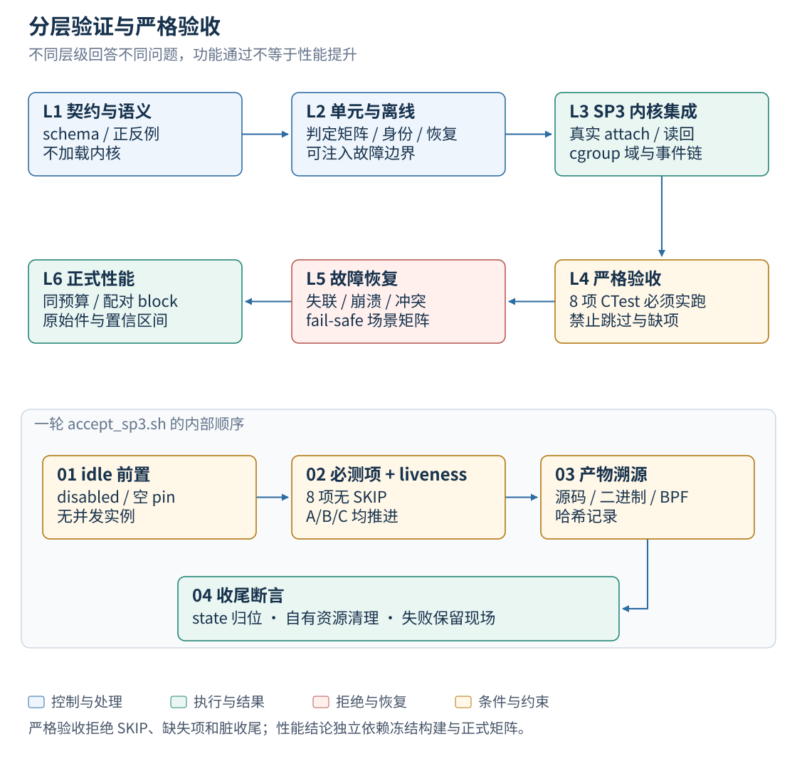
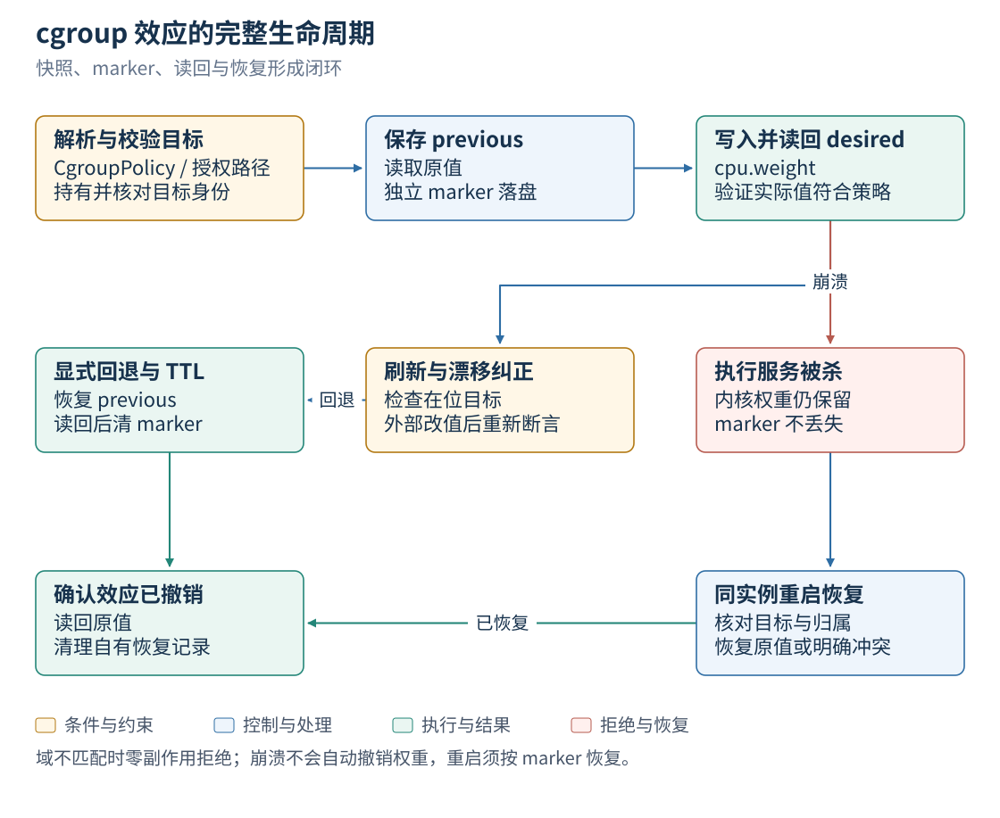
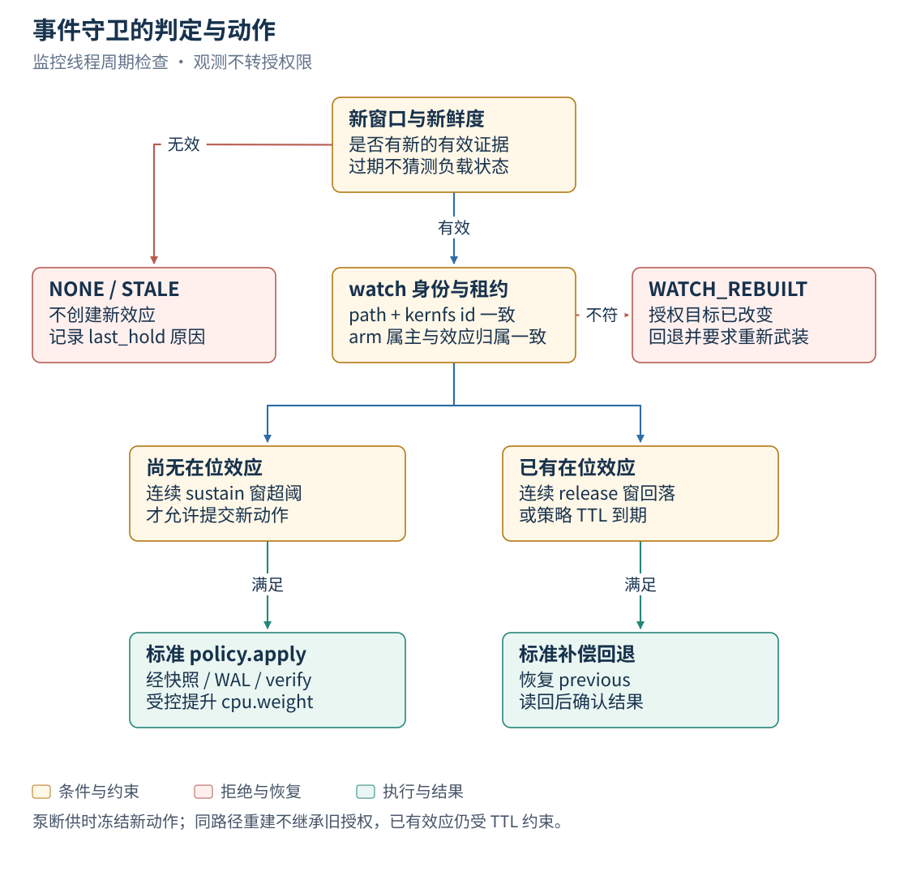
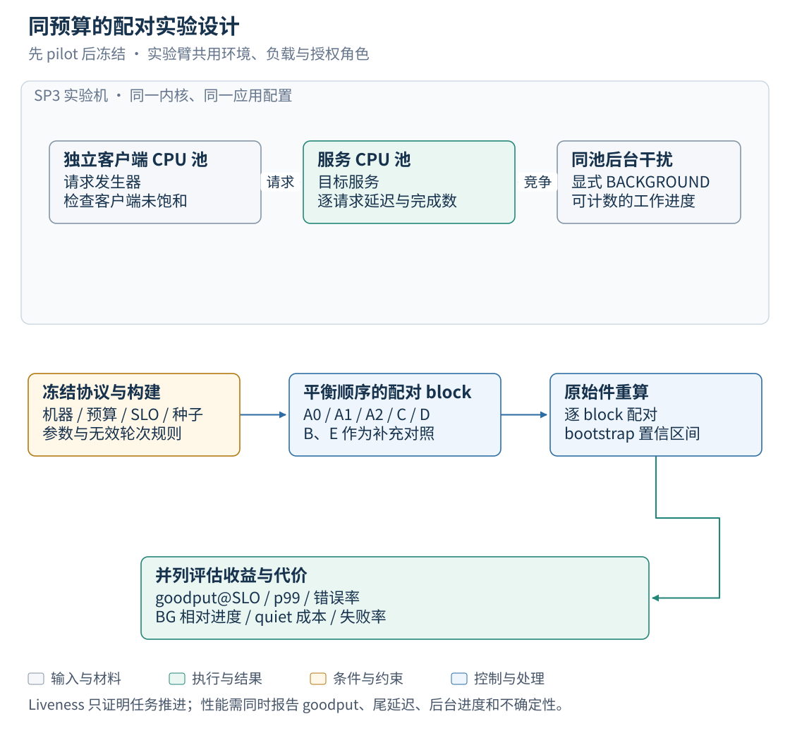
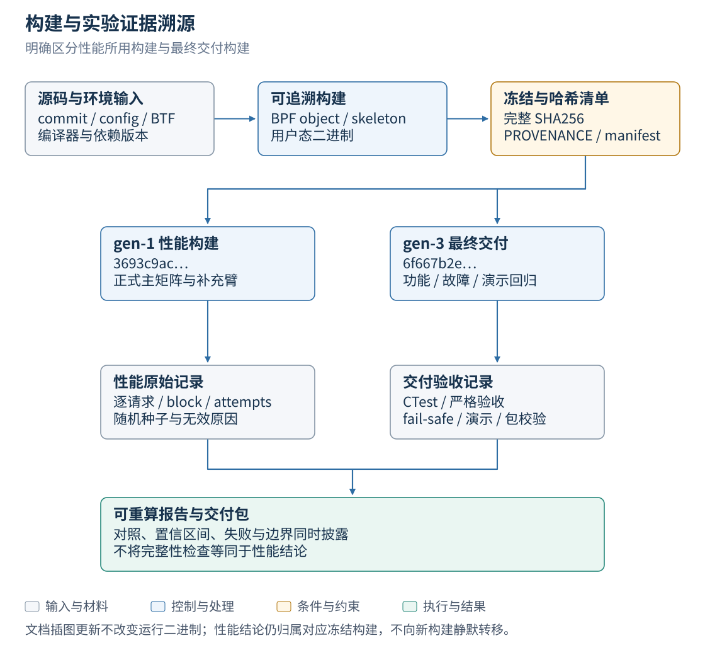

# EulerPilot v2 测试文档

| 文档名称 | EulerPilot v2 测试文档 |
|---|---|
| 文档版本 | v1.1 |
| 文档类型 | 测试文档 |
| 文档状态 | 正式发布 |
| 适用对象 | 评审专家、测试工程师、验收人员 |
| 维护团队 | 三驱兄弟(西安邮电大学) |
| 更新日期 | 2026-10-26 |
| 测试环境 | openEuler 24.03 LTS-SP3,内核 `6.6.0-schedpilot-sp3`,8 vCPU / 16 GiB,root |
| 被测构建 | gen-1 `3693c9ac…`(性能结论)、gen-3 `6f667b2e…`(最终交付),见 `evidence/p1/frozen-build-20261025.txt` |

> 本系统管理的是内核调度器与 cgroup 资源,测试要回答的问题比"功能对不对"多一层:
> 策略生效之后,内核里的状态是否真的与声称一致;进程崩溃、磁盘写满、外部越权修改
> 之后,系统是否仍能回到安全状态。因此每层测试都有明确判定词汇,**能力缺失时用
> UNSUPPORTED/SKIP 如实标注,不用 PASS 遮盖**。

## 判定词汇

表 1 词汇与含义

| 词汇 | 含义 | 使用条件 |
|---|---|---|
| PASS | 断言全部成立 | 该层前置条件满足且实际执行 |
| FAIL | 至少一条断言不成立 | 保留现场并归档失败轮 |
| SKIP(退出码 77) | 前置条件不满足,未执行 | 非 root、无 sched_ext、非 cgroup2fs、pin 非空 |
| UNSUPPORTED | 能力在本版本不存在 | 设计上未启用或环境不支持,附理由 |
| not run | 判定分辨率不足,主动不执行 | 声明敏感度不大于实测噪声(协议 §5.1) |

## 目录

1. [文档背景](#1-文档背景)
2. [六层测试体系](#2-六层测试体系)
3. [设计契约层](#3-设计契约层)
4. [单元测试](#4-单元测试)
5. [内核集成测试(8 项)](#5-内核集成测试8-项)
6. [一键验收](#6-一键验收)
7. [故障恢复矩阵(17 条目)](#7-故障恢复矩阵17-条目)
8. [性能测试](#8-性能测试)
9. [测试数据管理](#9-测试数据管理)
10. [已知限制](#10-已知限制)
11. [附录:证据索引](#11-附录证据索引)
12. [修订记录](#12-修订记录)

## 1. 文档背景

测试体系按层设计——设计契约、单元、内核集成、一键验收、故障恢复、性能——每层有
明确的通过标准与失败处置。逐项证据文件在 `evidence/` 目录,每个文件含完整性与边界
章节;实验方法的预注册协议见 `docs/EXPERIMENT_PROTOCOL.md`;构建与验证命令见
`docs/部署文档.md` 第 6 章。

## 2. 六层测试体系

*图 1　分层验证与严格验收*

表 2 层级与判据

| 层 | 对象 | 工具 | 通过标准 | 结果 |
|---|---|---|---|---|
| L1 设计契约 | schema 与示例 | `scripts/validate_design.py` | 6 正例通过、27 反例被拒 | PASS |
| L2 单元 | 判定逻辑、解析、状态机 | `tests/unit/`(CTest: `unit`) | 587 断言全过 | PASS |
| L3 内核集成 | 真实挂载/写读/恢复 | `tests/integration_*.sh`(7 项)+ unit | 8/8 且 0 SKIP | PASS |
| L4 一键验收 | 端到端 + 环境断言 + 哈希 | `scripts/accept_sp3_rounds.sh` | 六轮全 rc=0 | r28/r29/r30 均 6/6 |
| L5 故障恢复 | 17 类故障注入 | `experiments/fail_safe_matrix_sp3.sh` | 17/17 | run8 + run9/10/11 |
| L6 性能 | 预注册矩阵 | `experiments/flagship_*.sh` | 见第 8 章 | 主结论带边界 |

层间纪律:L1/L2 不需要 root 与内核,可离线复跑;L3–L6 必须在 SP3 上执行,其他
系统的结果不得替代;L6 与 L5 不得并发(锁文件互斥)。

## 3. 设计契约层

五个 schema 加 `EventArm`,全部 Draft-07 且 `additionalProperties:false`。
`scripts/validate_design.py` 对每个契约跑正例 + 一组语义反例。

表 3 契约与反例覆盖

| 契约 | 正例 | 代表性反例 |
|---|---|---|
| `action-envelope` | `apply-action.json`、`rollback-action.json` | 缺 `deadline`、非法时间戳、apply 携带 `rollback_of`、rollback 缺原动作 |
| `scheduling-policy` | `redis-policy.json` | 未知字段、`class=SUPER`、切片越界、`policy_ttl ≤ min_dwell` |
| `cgroup-policy` | `cgroup-protect-scope.json` | `cpu_weight=0/20000`、effects 超过 8 条、路径含 `..`、重复路径 |
| `event-arm` | `event-arm.json` | 阈值越界、sustain/release=0、`action.cpu_weight` 越界 |
| `skill-manifest` | `sched-skill.json` | apply 缺 snapshot/verify/rollback/reconcile、非法 `effect_scope` |

该层自检输出的 JSON 固定携带 `"runtime_verified": false` 与
`"performance_verified": false`,防止把契约检查读成运行时验证。

## 4. 单元测试

587 个断言(`tests/unit/test_main.cpp`,3145 行)。断言数随构建代次增长:443 →
478(cgroup 域)→ 550(事件链)→ 572 → **587(gen-3,cgroup 双写拒绝)**,引用时
须指明代次。

表 4 覆盖分布

| 主题 | 代表测试 | 覆盖点 |
|---|---|---|
| 策略校验真值表 | `test_policy_validation`、`test_cgroup_policy_validation` | 字段、范围、枚举、未知字段、路径穿越、`class⇔role` 一致性 |
| 事务状态机 | `test_wal_faults`、`test_idempotency` | WAL 顺序、幂等重放、同键异容拒绝、世代号冲突 |
| 目标绑定 | `test_target_binding` | pidfd 持有、cgroup 重建失效、成员迁出撤销 |
| 回退自证 | `test_rollback_proves_class_removal` | `class-del` 后必须 `class-get` 读回不存在;残余 cfg/class 使 `verify_rolled_back` 失败 |
| 优雅停止 | `test_executor_shutdown_releases_active_effect` | 停止信号触发完整补偿回退,不留 pin |
| 存储降级 | `test_lease_survives_unwritable_state_store` | 注入 `state.json` 写失败:仅内存租约、拆放行、建新拒绝、`store_warning` |
| 在位性与接管 | `test_sched_liveness_takeover`、`test_sched_abort_foreign_pin` | 连续 3 次失败才回退;外域 pin 不触碰 |
| class 漂移 | `test_class_drift_sample_corrected` | 轮换抽样再断言 |
| cgroup 生命周期 | `test_cgroup_skill_lifecycle` | 快照 → 写 → 读回 → 漂移纠正 → marker 恢复 |
| 事件判定 | `test_event_apply_gate` 等五项 | 持续/回落滞回、证据门、WATCH_REBUILT、身份匹配、泵零写入 |
| 门控矩阵 | `test_slo_gate` | 服务半区、绝对上限、分辨率护栏跳过、观测断供 |

运行:`cd <build> && ctest -R unit`。

## 5. 内核集成测试(8 项)

CTest 注册 8 项(`unit` 与 7 项 `integration*`),`RUN_SERIAL` 强制串行,前置条件
不满足时按设计 `exit 77`(SKIP),验收层把 SKIP 判为失败。其中
`integration_events`、`integration_fd`、`integration_lease`、`integration_ttl` 仅在
BPF 工具链齐备时注册;严格校验器 `scripts/check_sp3_acceptance.py` 要求 8 个名字全部
出现且无 SKIP,缺项与跳过同样判失败。

表 5 逐项说明

| 测试 | 覆盖 | 关键断言 | SKIP 条件 |
|---|---|---|---|
| `integration` | 执行服务基本事务 | apply→verify→rollback 全链;幂等重放返回首次结果;同键异内容拒绝 | 非 root |
| `integration_sched` | `--skill sched-ref` 挂载 | 子进程 loader 生命周期;loader 崩溃即 detach;pin 回收 | 无 sched_ext |
| `integration_fd` | FD 传递生产路径 | link fd 带 CLOEXEC;`ops=eulerpilot`;class 从内核 map 读回 | 无 sched_ext |
| `integration_lease` | 租约互斥 | 异属主拒绝;租约到期自动回退并清 pin | 非 root |
| `integration_ttl` | 策略 TTL | 到期自动回退;无 pin 残留;世代号推进 | 非 root |
| `integration_cgroup` | cgroup 动作域 | 见 5.1 | 非 cgroup2fs / 无 systemd-run |
| `integration_events` | 事件链六相 | 见 5.2 | 无 BPF 能力 |
| `unit` | 单元测试 | 587 断言 | — |

### 5.1 cgroup 域步骤(`tests/integration_cgroup.sh`)

*图 2　cgroup 效应的完整生命周期*

本项固定断言：初值 100 → apply 300（marker.previous=100）→ 旁路改为 77 后刷新纠正为 300 → rollback 恢复 100 并清 marker。跨域 SchedulingPolicy 请求须零副作用拒绝；再次 apply 后 SIGKILL 并重启，应按 marker 恢复 100。

### 5.2 事件链六相(`tests/integration_events.sh`,一项测试内的连续时间线)

*图 3　事件守卫的判定与动作*

| 相 | 场景 | 断言 |
|---|---|---|
| 1 | 空载 | 不动作(证据门 NONE/低于阈值) |
| 2 | 制造饥饿 | 连续 sustain 窗超阈 → 升权 100 → 5000 |
| 3 | 撤除负载 | 连续 release 窗回落 → 补偿回原值 |
| 4 | 杀掉泵 | 门冻结(`STALE`),已生效动作由 TTL 兜底回退 |
| 5 | 删除并重建同路径 cgroup | `WATCH_REBUILT`,拒绝动作,权限不转授给新对象 |
| 6 | 泵单独运行 | 对被看目录零写入(泵只读) |

## 6. 一键验收

`scripts/accept_sp3_rounds.sh <标签> <build> <src> <轮数>` 每轮执行:

按图 1 下半部分的顺序执行：idle 前置断言 → 八项 CTest（拒绝 SKIP/缺项/重名）与 A/B/C liveness → 源码及产物哈希 → 收尾状态断言。liveness 仅证明三臂持续推进。

表 6 累计验收记录

| 轮次组 | 构建 | 结果 |
|---|---|---|
| r28(六轮) | gen-1 | 6/6 rc=0 |
| r29(六轮) | gen-2 | 6/6 rc=0 |
| r30(六轮) | gen-3 | 6/6 rc=0 |

## 7. 故障恢复矩阵(17 条目)

驱动 `experiments/fail_safe_matrix_sp3.sh`。每条断言三件事:**目标进程继续推进、
内核状态由 map/文件自证清除、无本场景新增 pin**(pin 判定使用逐场景基线,不用全局
空判定)。

表 7 逐条场景与断言

| 编号 | 注入的故障 | 断言内容 | 结果 |
|---|---|---|---|
| S01 | class 模式挂载 + 回退 | apply `VERIFIED`;内核 `class_map` 读回 svc=LAT、bg=BG;回退语含 "no class or cfg outlives the unpin",无 "class revocation unconfirmed";pin 目录消失;worker 存活 | PASS |
| S02 | basic 模式挂载 + 回退 | BG 由角色隐式生效;回退后 `state=disabled` | PASS |
| S03 | adaptive 模式 apply | `REJECTED` 且回复点名 adaptive;`disabled`、零新 pin | PASS |
| S04 | 挂载中 SIGKILL 执行服务 | 内核 15s 内回 `disabled`;同实例重启复用 instance_id 并扫掉崩溃遗留 pin;`degraded=false`;worker 持续推进 | PASS |
| S05 | `sched-ref` 下 SIGKILL loader | 内核即 detach、pin 回收;日志 `auto fallback`(3 次存活判定 ≈3s) | PASS |
| S06 | 租约 TTL=4000ms 不续租 | 自动回退 + 日志 `lease expired` + pin 清空 | PASS |
| S07 | `policy_ttl_ms=10000`(schema 下限)配长租约 | 自动回退 + 日志 `policy TTL expired` | PASS |
| S08 | 未知字段 / `class=SUPER` | 各 `REJECTED`;`disabled`、无新 pin、世代号不移动 | PASS |
| S09 | `max_bg_wait_ms=20000`、`max_foreground_p99_ms=5000.0`(浮点填整数字段) | 均 `REJECTED`,零副作用 | PASS |
| S10 | 裸 RPC `expected_generation+7` | `GENERATION_CONFLICT`;内核状态与 pin 数不变 | PASS |
| S11 | 同状态目录起第二实例 | 拒绝且日志含 "another executor";未挂载 | PASS |
| S12 | 越权旁路写(`ep-schedctl set lat_slice_ns=4000000`、`class-set --class COMP`) | cfg 在刷新周期内被再断言(日志 `cfg drift corrected`);class 条目轮换抽样纠正;回退 | PASS |
| S13 | BG 成员迁出声明的 cgroup | `class-get` 读回不存在;迁回后重新分类为 BG | PASS |
| S14 | 状态目录为 4MiB tmpfs 并灌满(ENOSPC) | 新效应被 `RECOVERY_REQUIRED` 拒绝;`status.store_warning` 非空;回退仍能到达 skill;pin 清空;`rollback.status ∈ {AUDIT_PENDING, EFFECT_RESTORED, ROLLED_BACK}` | PASS |
| S15 | 挂载期间下线 cpu7 | 本内核会注销调度器:必须在 15s 内报 `auto fallback`/`liveness miss`,shutdown 后无 pin;若内核容忍热插拔则 `enable_seq` 不动且不得误报 | PASS |
| S16 | 无法在 v2 构造的条目(非注入) | 如实标注四条(见 7.2) | PASS |
| S17 | helper 包装器只拒绝 `class-set`(两步写入第二步失败) | `ROLLED_BACK` + `error.code=APPLY_FAILED` + 回复点名 class-set;`generation=0`;无 pin;worker 推进;换回真 helper 重试 `VERIFIED` | PASS |

表 8 多轮复跑

| 轮次 | 构建 | 结果 | 备注 |
|---|---|---|---|
| run4 | 修复前 | S14 FAIL(16 条目) | 现场保留于 `evidence/p1/fail-safe-20261024-run4/` |
| run6/run7 | 修复中 | 驱动缺陷致 rc=1 | 保留(归档顺序曾覆盖本地 run4 树,已重新取回) |
| run8 | gen-1 前 | **17/17 rc=0** | P1 判定依据 |
| run9 / run10 / run11 | gen-1 / gen-2 / gen-3 | **17/17** | 交付级复跑 |

### 7.1 矩阵暴露并修复的产品缺陷

| 缺陷 | 症状 | 修复 |
|---|---|---|
| 停止信号不清理 pin | run2 的 S12/S15 各泄漏 5 个 map pin | 新增 `Executor::shutdown()`,仍有效应则走同一条补偿回退(含 `verify_rolled_back`) |
| 撤销只看 cfg | `class-del` 后条目可能仍在 | 撤销后 `class-get` 读回确认;孤儿回收从 `sched-runtime.json` 的 `classified` 重建受管集合 |
| cfg 无漂移纠正 | 越权改值长期生效 | 刷新周期全量再断言(实测约 5ms/次) |
| 盘满时回退被挡死 | `lease.acquire` 写 `state.json` 失败即拒绝回退,并误报 `SCHEMA_INVALID` | 方向不对称:授予仅内存租约(`lease_persisted:false`),拆效应放行、建新效应 `RECOVERY_REQUIRED`;契约登记于 `docs/p1/ABI_FREEZE.md` §6 第 8 条 |

### 7.2 测试件自身缺陷(如实记录)

驱动本身在收口过程中出过五类问题,均已修正:全局"pin 根必须为空"的判定被前序场景
污染(改为逐场景基线)、S04 曾错误断言崩溃时 pin 应消失(真实语义是同实例重启清扫)、
S07 使用了低于 schema 下限的 TTL(策略根本没被接受)、S12 注入了低于 helper 下限的
切片值(测到的是校验而非漂移)、S14 在场景内 `umount` 因守护进程仍持有 socket/锁/
日志而 EBUSY(改到 EXIT  trap 重试)、S17 断言标签写错(正确契约是 `ROLLED_BACK` +
`APPLY_FAILED`)。

### 7.3 S16 的如实标注

| 场景 | 标注 | 理由 |
|---|---|---|
| PMU 读取被拒 | UNSUPPORTED | 无 PMU 消费者,没有可测路径(`doctor.py` 记 `pmu_read_test NOT_RUN`) |
| 停止心跳 | UNSUPPORTED by design | `heartbeat_ns` 仅 adaptive 路径读取,v2 从不写 |
| 真机 PID 复用 | SKIP | pidfd 已在结构上排除复用;调 `kernel.pid_max` 测的是内核不是代码 |
| TID 粒度目标 | 超出 P1 范围 | `class_map` 以 tgid 为键 |

## 8. 性能测试

### 8.1 方法(预注册)

*图 4　同预算的配对实验设计*

协议 `docs/EXPERIMENT_PROTOCOL.md` + 参数 `experiments/flagship_params.json`,先注册
后执行。

表 9 负载与统计设定

| 项 | 值 |
|---|---|
| 负载 | Redis 开环(固定到达率,服务变慢时压力不降) |
| offered | 60000 rps;GET/SET 各 60s,预热 10s |
| 客户端 | 8 连接、keypool 100k、值 64B |
| SLO | 5ms;超时 50ms |
| 指标 | goodput@SLO(按逐请求原始数据统计) |
| 设计 | 20 block × 5 臂,块内配对 |
| 统计 | 配对 block bootstrap 10000 次,95% CI,seed 20261024 |
| 无效规则 | 预注册;低吞吐与高方差不构成剔除理由 |

表 10 臂定义

| 臂 | 内容 |
|---|---|
| A0 | 默认调度器(fair),无干预 |
| A1 | fair + 同等观测栈 + shadow 决策(不挂载) |
| A2 | fair + 静态 cgroup 倾斜(`cpu.weight=200`) |
| B | BASIC 模式 scx + 观测 |
| C | CLASS 模式 scx,固定 expert |
| D | ADAPTIVE 规则路由 + 门控 |
| E | 参考实现 `schedpilotd`(互斥运行) |
| X | 上游 scx 调度器 —— **UNSUPPORTED**(见 10.1) |

### 8.2 主结果(冻结构建复现轮,`evidence/p2/flagship-rerun-20261025.txt`)

表 11 主对照(goodput@5ms,块内配对,95% CI)

| 对照 | GET | SET | 胜/负(GET / SET) | p99 |
|---|---|---|---|---|
| C vs A0 | **+1.83% [1.38, 2.26]** | +1.39% [0.82, 1.58] | 20/0、18/2 | −39.6% / −32.8% |
| D vs A0 | +1.74% [1.24, 2.19] | +1.05% [0.59, 1.40] | 19/1、17/3 | −37.9% / −31.1% |
| A1 vs A0 | −0.55% [−0.94, +0.14] | −0.68% [−1.17, −0.19] | 7/13、4/16 | 观测栈成本(如实披露) |
| D vs C | −0.19% [−0.33, +0.14] | — | 统计打平 | — |
| BG 相对进度 | 0.998–1.006 | | | 后台未受损 |

首轮矩阵(`evidence/p2/flagship-matrix-20261023.txt`)给出同向但不同的点估计:C vs
A0 GET +1.62% [+1.53, +1.82] 20/0、p99 −47.9%;p99 绝对值 A0 GET 8.023ms → C
4.191ms。**引用数字须指明轮次**。

表 12 补充臂(10 block,冻结构建)

| 对照 | 结果 | 出处 |
|---|---|---|
| B vs A0 | GET +1.75% [1.45, 2.09],10/0;p99 −40.8% | `evidence/p2/barms-20261025.txt` |
| E vs A0 | GET +1.92% [0.94, 2.17],10/0;p99 −49.4%;SET +0.03%(5/5 打平) | `evidence/p2/earms-20261025.txt` |
| C vs A2(静态倾斜) | +1.90% [1.63, 2.32],20/0 | 首轮矩阵(10-23) |

### 8.3 阈值敏感性(同报,不挑阈值)

表 13 goodput 差随 SLO 变化

| 阈值 | C vs A0(GET) | 其他 |
|---|---|---|
| @1ms | 首轮 +2.61%;复现轮 +2.5% | B 臂 +2.70%;E 臂 +7.0%(n=10,探索性) |
| @2ms | 首轮 +0.55%;复现轮 −0.30% | C SET −0.17%(首轮)/ −1.52%(复现);D SET −0.57% / −1.37%;B GET −0.25% |
| @5ms | 首轮 +1.62%;复现轮 +1.83% | 主结论 |
| @10ms | 首轮 +0.51%;复现轮 ≈+0.6% | — |

结论:**收益集中在 5ms 以上的远尾,2ms 附近没有优势甚至略负**。这一点主动写入
结论边界,不作为可选口径。

### 8.4 归因与消融

| 实验 | 结果 | 含义 |
|---|---|---|
| class 路由配对消融(Cc vs C) | GET −0.01% [−0.29, +0.24],10/10 | 该负载上 class 路由不带来收益 |
| class 路由(Dc vs D) | GET −0.18% [−0.45, −0.02] | 自适应臂上加 class 略负 |
| mixed-foreground 双前台 | A0 联合 SLO 0/3(svc-B 仅交付 77%);D 2/3;Dnc(无 class)2/3 | 改善与 class 声明无关 |
| 增量链 A1 → B → C | −0.5% → +1.75% → +1.83% | 收益来自数据面切片/预算形态 |
| 门控注入(D vs Dng) | D 第 26 次轮询(≈52s)才切换,Dng 第 6 次(≈12s);25 次 deny 全为 `FOREGROUND_P99_EXCEEDED` | 门控是"延迟器",代价上界约 40s |
| 过载区间双稳 | 同臂波动 85–93%,配对差 −4.6/−17.4/+170.8/−23.7%,CI 跨 0 | 该区间不可测,不引用中位数 |

### 8.5 观测与开销

| 项 | 数值 | 出处 |
|---|---|---|
| 事件泵 CPU | 0.31s / 60s ≈ **0.5% 单核** | `evidence/p4/pump-overhead-20261025.txt` |
| 事件吞吐 | 726,919 wakeup 追踪 / 723,525 等待聚合 ≈ 12.1k 事件/s;pid 复用丢弃 0、聚合丢失 0 | 同上 |
| 泵对 goodput 的影响 | 配对中位差 −0.010%,范围 [−0.049, +0.592] | 同上 |
| 泵对 p99 的影响 | 中位 +10.4% [−27.4, +124.1],与已知噪声同量级 → **只声称"分辨不出",不声称无影响** | 同上 |
| 观测分辨率 | 同状态 8 窗 p99 极差/均值 46%;加载 30s 窗 p99 CV 20.2% | 协议 §5.1 |
| 切换空窗 | 303–665ms;空窗内 1ms 探针 p99 由 1.2–2.0ms 升至 13.2–16.1ms | `docs/HANDOVER_20261024.md` §3.2 |

## 9. 测试数据管理

*图 5　构建与实验证据溯源*

- **环境指纹**:每轮验收与矩阵记录内核、构建哈希、臂序(种子驱动)、负载参数;
  manifest 含 `tested_code_commit` 与产物 SHA256。
- **原始数据**:逐请求延迟(8 字节定长记录)留在测试机 `/root/epv2-evidence/`
  (一次旗舰约 5.8GB);仓库入库汇总、`comparisons.csv` 与 `SHA256SUMS`。
- **可重算校验**:汇总数字必须能由原始件重算,校验项
  `CHECK_RAW_REBUILDS_SUMMARY`,偏差 ≤0.5%。
- **保留纪律**:正式构建之后受影响的矩阵必须重跑;失败轮与作废轮全部保留
  (`-run4/`、`-run6/` 即历史失败样例);性能运行与故障注入分开执行。
- **命名**:同日多轮加 runN 后缀,禁止覆盖;归档前先取回远端副本再改名(曾发生
  本地树被覆盖)。
- **证据结构**:每个证据文件含"完整性"与"边界"章节,写明未覆盖项。

## 10. 已知限制

表 14 限制清单

| 限制 | 判定 | 说明 |
|---|---|---|
| 跨机/集群验证 | UNSUPPORTED | 备用机 SP4 为 cgroup v1 且无 PSI |
| X 臂(上游 scx 对照) | UNSUPPORTED | 上游主线已 Rust 化且目标内核高于本机 6.6,无法公平构建 |
| adaptive 模式 | UNSUPPORTED by design | apply 阶段拒绝;协议 §8 的心跳双模式要求无法满足 |
| 心跳降级 | UNSUPPORTED by design | `heartbeat_ns` 仅 adaptive 路径读取 |
| PMU 分类 | UNSUPPORTED | 无 PMU 消费者 |
| 真机 PID 复用 | SKIP | pidfd 结构性排除 |
| TID 粒度目标 | 超出范围 | `class_map` 以 tgid 为键 |
| stall 类缺陷 | 未穷尽 | 17 条目无"排队任务卡死"主动构造;该根因由独立实验定位修复 |
| BPF 聚合 map 饱和 | 未构造 | 上限 4096 个 cgroup |
| 事件授权持久性 | 设计限制 | watch 按 path + kernfs id 匹配,重建即失效,需重新武装 |
| 性能结论范围 | 限定 | 单机、单负载(Redis)、单 SLO 设定;@2ms 无优势 |
| 后台任务结论 | 限定 | 结论是"未受损",不是"被优化";CPU 争抢下 BG 进度反而升高使 `BG_PROGRESS_FLOOR` 不响 |
| 静息 p99 | 环境因素 | 静息 1.7ms 主因是 idle 退出延迟,非策略效果 |

## 11. 附录:证据索引

表 15 结论 → 证据文件

| 结论 | 证据 |
|---|---|
| fail-safe 17/17 与两缺陷修复 | `evidence/p1/fail-safe-20261024.txt`、`docs/p1/P1_EXIT_REPORT.md` |
| 冻结构建哈希与 r28/run9 | `evidence/p1/frozen-build-20261025.txt` |
| class 越权漂移抽样纠正 | `evidence/p1/class-drift-20261025.txt` |
| 旗舰主表(复现轮) | `evidence/p2/flagship-rerun-20261025.txt` |
| 旗舰主表(首轮)与 C vs A2 | `evidence/p2/flagship-matrix-20261023.txt` |
| class 路由消融 | `evidence/p2/flagship-classrouting-20261023.txt` |
| 消融四项 | `evidence/p2/flagship-ablations-20261023.txt` |
| B / E 补充臂 | `evidence/p2/barms-20261025.txt`、`evidence/p2/earms-20261025.txt` |
| 门控注入 | `evidence/p2/gate-injection-20261023.txt` |
| mixed-foreground | `evidence/p2/mixed-fg-noclass-20261025.txt` |
| cgroup 动作域 | `evidence/p4/cgroup-domain-20261024.txt` |
| 事件链闭合 | `evidence/p4/events-link-20261025.txt` |
| 泵开销 | `evidence/p4/pump-overhead-20261025.txt` |
| 演示彩排 | `evidence/p5/demo-rehearsals-20261025.txt` |
| R1–R10 判定 | `docs/ACCEPTANCE_20261025.md` |

## 12. 修订记录

| 版本 | 日期 | 内容 | 作者 |
|---|---|---|---|
| v1.0 | 2026-10-25 | 随交付创建 | 三驱兄弟 |
| v1.1 | 2026-10-25 | 扩充:判定词汇、六层判据表、契约反例表、单元覆盖分布、8 项集成逐条与 SKIP 条件、验收轮次记录、fail-safe 17 条逐条断言 + 多轮复跑 + 产品/测试件缺陷、性能方法与臂定义/主表/敏感性/消融/开销、数据管理纪律、限制清单、证据索引 | 三驱兄弟 |
| v1.1 图示修订 | 2026-10-26 | 补充 SVG 架构、流程与验证示意图及可编辑源文件；图示按当前实现标注边界，性能数据口径不变 | 三驱兄弟 |
