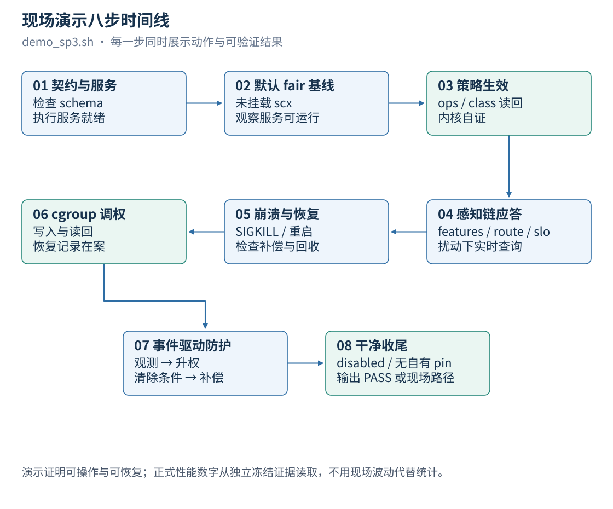

# EulerPilot v2 用户手册

| 文档名称 | EulerPilot v2 用户手册 |
|---|---|
| 文档版本 | v1.1 |
| 文档类型 | 用户手册 |
| 文档状态 | 正式发布 |
| 适用对象 | 使用本系统执行策略、观测负载、运行演示的操作人员 |
| 维护团队 | 三驱兄弟(西安邮电大学) |
| 更新日期 | 2026-10-26 |
| 运行环境 | openEuler 24.03 LTS-SP3,内核 `6.6.0-schedpilot-sp3`,root |
| 配套文档 | 部署文档(装环境)/ 设计文档(为什么)/ 测试文档(结论来源) |

> 本手册面向**已经部署好的环境**。安装与构建见 `docs/部署文档.md`。全文命令按
> 下表口径书写,替换为实际值即可。

## 命名约定

表 1 文中写法

| 文中写法 | 含义 |
|---|---|
| `<BUILD>` | 冻结构建目录,镜像内为 `/root/epv2-build` |
| `<SRC>` | 源码目录,镜像内为 `/root/epv2-src` |
| `<STATE>` | 执行服务状态目录,例 `/run/eulerpilot-v2/executor` |
| `<SOCK>` | 控制 socket,默认 `<STATE>/executor.sock` |
| `ep` / `ep-executord` | 客户端与执行服务,位于 `<BUILD>/` |
| `<scope>` | systemd 创建的 cgroup v2 scope 路径 |

## 目录

1. [文档背景](#1-文档背景)
2. [快速开始](#2-快速开始)
3. [启动选项](#3-启动选项)
4. [CLI 参考](#4-cli-参考)
5. [三类策略编写](#5-三类策略编写)
6. [状态解读](#6-状态解读)
7. [故障排查速查](#7-故障排查速查)
8. [常见问题](#8-常见问题)
9. [附录:命令速查](#9-附录命令速查)
10. [修订记录](#10-修订记录)

## 1. 文档背景

EulerPilot v2 通过声明式策略管理 sched_ext 调度器与 cgroup 资源,并提供负载观测、
SLO 门控与事件驱动防护。使用模型一句话概括:**启动执行服务后,一切写操作通过
`ep` CLI 提交声明式策略完成;系统负责验证、生效、监控与回退;用户随时可以查询
完整状态。**

表 2 日常任务与本手册位置

| 你要做的事 | 章节 |
|---|---|
| 五分钟看一遍系统能干什么 | 2.1 演示 |
| 手工生效一条调度策略 | 2.2 最小手动流程 |
| 起一条 cgroup 权重调整 / 事件防护 | 2.3、2.4 |
| 查参数与命令 | 第 3、4 章 |
| 写策略(含完整示例与常见错) | 第 5 章 |
| 看不懂 `ep status` 输出 | 第 6 章 |
| apply 被拒、事件守卫不动、盘满 | 第 7 章 |

## 2. 快速开始

### 2.1 运行演示(推荐第一步)



*图 1　现场演示八步时间线*

约 5–6 分钟,自动完成八步时间线:

```bash
bash <SRC>/scripts/demo_sp3.sh <BUILD>/ep-executord <BUILD>/ep \
  <BUILD>/ep-sched-loader <BUILD>/ep-evtmon <EVIDENCE>/demo-run
```

演示依次展示:契约校验 → 默认调度器基线 → 策略生效(内核自证)→ 扰动下的感知链
应答 → 崩溃恢复 → cgroup 权重调整 → 事件驱动防护(升权与补偿)→ 干净收尾。每步
打印 `=== [demo] 步骤名 ===` 与说明行;失败时保留现场目录并在结尾打印路径。

### 2.2 最小手动流程(调度域)

```bash
# 0. 前置检查:必须 disabled 且本实例 pin 目录为空
cat /sys/kernel/sched_ext/state            # 期望 disabled
ls /sys/fs/bpf/eulerpilot-v2 2>/dev/null   # 期望为空或不存在
python3 <SRC>/scripts/doctor.py            # 只读能力体检

# 1. 启动执行服务(生产建议 setsid nohup 后台运行,日志落盘)
setsid nohup <BUILD>/ep-executord --state-dir <STATE> --socket <SOCK> \
  --skill sched --loader <BUILD>/ep-sched-loader --sched-ctl <BUILD>/ep-schedctl \
  > <STATE>/daemon.log 2>&1 &

# 2. 校验策略(不生效,可反复跑)
ep validate --file policy.json --socket <SOCK>

# 3. 取租约并生效
ep lease --ttl-ms 600000 --socket <SOCK>
ep apply --file policy.json --idempotency-key run-001 --ttl-ms 600000 --socket <SOCK>

# 4. 观察与回退
ep status --socket <SOCK>
ep rollback --of <action_id> --transaction <txn> --snapshot <snap> \
  --policy-sha256 <sha> --socket <SOCK>
```

`action_id`、`transaction`、`snapshot`、`policy_sha256` 四个凭据取自 apply 返回的
JSON,**不可手工构造**。回退成功的判据是响应 `status=ROLLED_BACK` 且
`/sys/kernel/sched_ext/state` 回到 `disabled`。

### 2.3 最小手动流程(cgroup 域)

```bash
# 用 systemd 创建带 CPUWeight 委派的 scope(直接 mkdir 的新 cgroup 可能无写权限)
systemd-run --scope -p CPUWeight=100 --unit epv2-demo.scope \
  redis-server --port 6399 &

# 起 cgroup 域执行服务(与调度域互斥:同一时间只跑一个写者)
setsid nohup <BUILD>/ep-executord --state-dir <STATE>-cg --socket <SOCK>-cg \
  --skill cgroup > <STATE>-cg/daemon.log 2>&1 &

ep apply --file cgroup-policy.json --idempotency-key cg-001 --socket <SOCK>-cg
cat /sys/fs/cgroup/system.slice/epv2-demo.scope/cpu.weight   # 期望策略声明值
ep rollback --of … --transaction … --snapshot … --policy-sha256 … --socket <SOCK>-cg
```

### 2.4 事件驱动防护(两进程)


*图 2　eBPF 事件驱动资源闭环*

```bash
# 1) 武装 cgroup 域执行服务(arm 是人工授权;watch 必须是活的 cgroup 目录)
setsid nohup <BUILD>/ep-executord --state-dir <STATE>-cg --socket <SOCK>-cg \
  --skill cgroup --event-arm arm.json > <STATE>-cg/daemon.log 2>&1 &

# 2) 起只读事件泵(它不写资源控制策略;杀掉它 = 观测断供 = 门冻结)
setsid nohup <BUILD>/ep-evtmon --socket <SOCK>-cg --window-ms 5000 \
  --interval-ms 1000 > <STATE>-cg/evtmon.log 2>&1 &

ep status --socket <SOCK>-cg      # 看 event 段:armed / 持续计数 / last_hold
```

行为:被看 cgroup 的唤醒等待连续 `sustain_windows` 窗超过 `threshold_wait_ms`,权重
升至 `action.cpu_weight`;连续 `release_windows` 窗回落、TTL 到期或泵停止后补偿回原值。

## 3. 启动选项

表 3 `ep-executord` 通用参数

| 参数 | 默认 | 说明 |
|---|---|---|
| `--state-dir DIR` | 按 uid 分配(`/run/eulerpilot-v2/executor` 等) | 状态目录:flock、WAL、marker、runtime 记录 |
| `--socket PATH` | `<state-dir>/executor.sock` | 控制 socket,0600 |
| `--skill sched\|sched-ref\|cgroup\|mock` | `sched` | 效果域。`sched` 为生产路径(FD 传递);`sched-ref` 子进程对照;`mock` 用于测试 |
| `--loader PATH` | `/usr/local/bin/ep-sched-loader` | sched 域加载器 |
| `--sched-ctl PATH` | `/usr/local/bin/ep-schedctl` | sched 域 cfg/class 辅助 |
| `--event-arm FILE` | 无 | 武装事件守卫(要求 `--skill cgroup`) |
| `--test-mode` | 关 | 允许 `intent` 直提(仅测试) |
| `--allow-any-uid` | 关 | 放宽 peer uid 校验(仅调试,生产不要开) |

表 4 AutoPilot 参数(全部需显式 `--auto-apply` 才生效)

| 参数 | 默认 | 合法范围 |
|---|---|---|
| `--auto-policy FILE` | 必填 | 基线策略文件 |
| `--auto-owner ID` | `autopilot-v2` | 租约属主标识 |
| `--auto-min-interval-ms` | 15000 | 1000–3600000 |
| `--auto-lease-ttl-ms` | 30000 | 1000–3600000 |
| `--auto-dwell-ms` | 60000 | 1000–3600000(驻留下限) |
| `--auto-candidate-hold-ms` | 15000 | 1000–3600000(候选保持) |
| `--auto-budget-window-ms` | 600000 | 1000–3600000(预算窗口) |
| `--auto-budget-max-switches` | 2 | 0–100(窗口内切换上限) |
| `--auto-outcome-windows` | 2 | 1–10(效果评估窗数) |
| `--auto-measured-downtime-ms` | 665 | 0–60000(切换空窗实测值) |

`--auto-*` 只与 `--skill sched|sched-ref` 组合有效。三个抑制参数共同限制"自动化不
要频繁抖":实测切换存在 303–665ms 空窗,因此默认预算是 10 分钟最多 2 次。

表 5 `ep-evtmon` 参数

| 参数 | 默认 | 说明 |
|---|---|---|
| `--socket PATH` | 必填 | 上报目标(执行服务的控制 socket) |
| `--window-ms N` | 5000 | 聚合窗口(100–60000) |
| `--interval-ms N` | 1000 | 排空与上报周期;必须严格快于窗口 |
| `--cgroup-root PATH` | `/sys/fs/cgroup` | 把 kernfs id 解析回路径的根 |
| `--duration-ms N` | 常驻 | 运行时长上限(到点自行退出) |
| `--print-only` | 关 | 只打印窗口不上报(排障用) |

## 4. CLI 参考

所有命令经 Unix socket 单请求单响应:一行 JSON 入、一行 JSON 出。socket 路径解析
顺序:`$EP_SOCKET` → `/run/eulerpilot-v2/executor/executor.sock` →
`$XDG_RUNTIME_DIR/eulerpilot-v2/executor/executor.sock` →
`/tmp/eulerpilot-v2-<uid>/executor.sock`。

表 6 `ep` 命令

| 命令 | 读写 | 功能 | 备注 |
|---|---|---|---|
| `ep status` | 读 | 实例、世代号、degraded、租约、观测、事件段 | 排障第一入口 |
| `ep validate --file F` | 读 | 策略校验 + 目标解析 + 摘要(dry-run) | 不取租约、不推进状态 |
| `ep lease [--owner O] [--ttl-ms N]` | 写 | 获取租约(默认 30000ms) | `apply`/`rollback` 会自动取 |
| `ep apply --file F [--idempotency-key K] [--ttl-ms N]` | 写 | 策略生效(全事务) | 同键同内容重放返回首次结果 |
| `ep rollback --of A --transaction T --snapshot S --policy-sha256 H` | 写 | 按原 apply 凭据回退 | 四凭据缺一不可 |
| `ep features` | 读 | FeatureWindow 快照 | 每个指标带 valid/age/来源 |
| `ep route` | 读 | 路由建议(专家档位 + 理由) | 仅建议,不生效 |
| `ep slo --expert E` | 读 | 门控判定(allowed + code) | 判定顺序:权限→证据→抑制 |
| `ep observe --file F` | 摄取 | 提交一窗服务观测 | 不推进世代号,不触发动作 |
| `ep reconcile` | 写 | 处理未完成事务 | degraded 时的第一步 |

表 7 退出码

| 码 | 含义 |
|---|---|
| 0 | 响应状态属于 `OK / VERIFIED / APPLIED / ROLLED_BACK` |
| 1 | 业务失败(`REJECTED`、`ROLLED_BACK` 之外的失败态、`DEGRADED`、`RECOVERY_REQUIRED`) |
| 2 | 参数错误、socket 不可达、响应超长或非法 JSON |

apply 的响应状态集合:`VERIFIED / REJECTED / ROLLED_BACK / DEGRADED /
RECOVERY_REQUIRED`。`REJECTED` 携带 `error.code`(见 `docs/设计文档.md` 表 15)。

## 5. 三类策略编写

### 5.1 调度策略(SchedulingPolicy)

```json
{
  "apiVersion": "eulerpilot.io/v1alpha1",
  "kind": "SchedulingPolicy",
  "metadata": {"name": "protect-redis"},
  "spec": {
    "scope": "scheduler-instance",
    "mode": "class",
    "expert": "latency-balanced",
    "source": "human",
    "targets": [
      {"kind": "cgroup", "path": "/sys/fs/cgroup/system.slice/redis.scope",
       "role": "FOREGROUND", "role_source": "explicit", "class": "LAT"},
      {"kind": "cgroup", "path": "/sys/fs/cgroup/system.slice/batch.scope",
       "role": "BACKGROUND", "role_source": "explicit", "class": "BG"}
    ],
    "parameters": {"lat_slice_ns": 1000000, "comp_slice_ns": 4000000,
                   "cache_slice_ns": 4000000, "bg_slice_ns": 2000000,
                   "preempt_threshold_ns": 500000, "bg_vtime_pct": 200,
                   "llc_affinity": false},
    "safety": {"min_dwell_ms": 5000, "max_observation_age_ms": 1000,
               "heartbeat_period_ms": 250, "heartbeat_timeout_ms": 2000,
               "policy_ttl_ms": 900000, "quiet_max_regression_pct": 5,
               "evaluation_min_bg_progress_ratio": 0.5,
               "bg_work_unit": "probe5s", "bg_progress_window_ms": 5000,
               "min_bg_work_units_per_sec": 140, "max_bg_wait_ms": 50,
               "max_foreground_p99_ms": 10,
               "fallback": "verified-safe-profile", "allow_affinity_change": false}
  }
}
```

表 8 关键字段

| 字段 | 取值 | 说明与常见错 |
|---|---|---|
| `spec.mode` | basic / class / adaptive | adaptive 会被拒绝(见 FAQ);写 adaptive 只是自我欺骗 |
| `spec.expert` | safe-basic / latency-balanced / throughput-balanced / cache-local | 白名单档位,不可自造名字 |
| `spec.source` | rule-template / offline-search / human / llm-proposal | 非 human 必须过门控 |
| `targets[].role` | FOREGROUND / BACKGROUND / NEUTRAL | BACKGROUND 必须显式声明,系统不猜 |
| `targets[].class` | NORMAL / LAT / COMPUTE / CACHE / BG | `class=BG` 必须配 `role=BACKGROUND`;`SUPER` 等自造值被拒 |
| `parameters.*_slice_ns` | 250000–10000000 | 低于 250000 会被 helper 拒绝 |
| `parameters.preempt_threshold_ns` | 100000–2000000 | — |
| `parameters.bg_vtime_pct` | 50–400 | 后台虚拟时间惩罚 |
| `safety.policy_ttl_ms` | 10000–3600000 | 效果硬上限,**必须 > min_dwell_ms** |
| `safety.min_dwell_ms` | 5000–300000 | 切换驻留下限 |
| `safety.max_observation_age_ms` | 100–10000 | 不得大于 `heartbeat_timeout_ms` |
| `safety.max_foreground_p99_ms` | 1–60000(可选) | 在线前向延迟绝对上限,单窗即判 |
| `safety.fallback` | verified-safe-profile / detach-to-fair | 回退目标 |
| `safety.allow_affinity_change` | 必须 false | 本系统不改亲和性 |

语义校验(schema 之外)会拒绝:未知字段、重复目标路径/PID、`heartbeat_timeout ≤
heartbeat_period`、`policy_ttl ≤ min_dwell`、`max_observation_age > heartbeat_timeout`、
`bg_progress_window > policy_ttl`、`class=BG` 与 `role` 不一致。

### 5.2 cgroup 策略(CgroupPolicy)

```json
{"apiVersion": "eulerpilot.io/v1alpha1", "kind": "CgroupPolicy",
 "metadata": {"name": "raise-weight"},
 "spec": {"scope": "cgroup-effects", "source": "human",
          "effects": [
            {"path": "/sys/fs/cgroup/system.slice/epv2-demo.scope", "cpu_weight": 300}
          ],
          "safety": {"policy_ttl_ms": 30000}}}
```

表 9 约束

| 字段 | 约束 | 说明 |
|---|---|---|
| `spec.effects` | 1–8 条 | 超过 8 条被拒;路径重复被拒 |
| `effects[].path` | `^/sys/fs/cgroup/…`,拒绝 `.` 与 `..` 段 | 必须位于挂载的 cgroup2 根之下 |
| `effects[].cpu_weight` | 1–10000 | 越界(如 0、20000)被拒,零副作用 |
| `spec.source` | 仅 `human` / `event-template` | 事件模板来源只能由武装 arm 使用 |
| `spec.safety.policy_ttl_ms` | 10000–3600000 | 到期自动回原值 |

注意:`CgroupPolicy` 只能提交给 `--skill cgroup` 的实例,`SchedulingPolicy` 只能提交
给 sched/cgroup 之外的调度域实例;不匹配时返回 `REJECTED` + `UNSUPPORTED` 且**不改
任何旋钮**。

### 5.3 事件授权(EventArm)

```json
{"apiVersion": "eulerpilot.io/v1alpha1", "kind": "EventArm",
 "metadata": {"name": "protect-batch"},
 "spec": {"watch": "/sys/fs/cgroup/system.slice/batch.scope",
          "threshold_wait_ms": 5, "sustain_windows": 1, "release_windows": 1,
          "min_interval_ms": 1000, "lease_ttl_ms": 30000,
          "policy_ttl_ms": 120000, "action": {"cpu_weight": 5000}}}
```

表 10 字段

| 字段 | 范围 | 调参建议 |
|---|---|---|
| `spec.watch` | 活 cgroup 目录 | 路径与 kernfs id 双匹配;重建后须重新武装 |
| `spec.threshold_wait_ms` | 1–60000 | 与负载稳态两侧留余量(实测稳态 3.8–4.3ms 贴着 5ms 会造成抖动) |
| `sustain_windows` / `release_windows` | 1–10 | 升权与回落的连续窗数,即滞回 |
| `min_interval_ms` | 1000–3600000 | 两次自动动作的最小间隔 |
| `lease_ttl_ms` | 1000–3600000 | 守卫租约 |
| `policy_ttl_ms` | 10000–3600000 | 升权效果硬上限 |
| `action.cpu_weight` | 1–10000 | 升权目标值 |

## 6. 状态解读


*图 3　启动恢复与降级判定*

`ep status` 是最常用的诊断入口。

表 11 关键字段

| 字段 | 含义 | 看到异常时 |
|---|---|---|
| `instance_id` | 本次执行服务实例标识 | 与 pin 目录名一致 |
| `generation` | 已提交变更计数(回退也推进) | 不推进说明动作未提交 |
| `degraded` | 存在未完成恢复 | 先 `ep reconcile`,再查 `startup_degraded_reason` |
| `startup_degraded_reason` | 启动时降级原因 | 常见:`unfinished transactions`、`orphan recovery failed…` |
| `store_warning` | 状态存储写失败警示(恢复后仍可见) | 磁盘满/权限问题,拆除仍可用但新效应被拒 |
| `lease` | 当前租约属主与到期时间 | 属主非自己 → `OWNERSHIP_CONFLICT` |
| `policy` / `effects` | 在位策略与效果摘要 | 与预期不符时先 `ep status` 再回退 |
| `service.*` | 服务观测:最新窗口、p99、后台进度、拒绝原因、断供高水位 | `SERVICE_OBSERVATION_STALE` = 观测断供 |
| `event.*` | 事件链:armed、持续/回落计数、`last_hold`、新鲜度、WATCH_REBUILT | 见第 7 章 |
| `last_fallback` | 最近一次自动回退原因 | `lease expired` / `policy TTL expired` / `auto fallback` / `liveness miss` |

日志侧对照(`daemon.log`):

表 12 常见日志行

| 日志 | 含义 |
|---|---|
| `[executor] orphan recovery: …` | 启动时回收了崩溃遗留效应 |
| `[executor] unresolved transaction …; executor starts DEGRADED` | 有未完成事务,需 reconcile |
| `[executor] orphan recovery failed: …; foreign resources left untouched` | 发现外域资源,未触碰(安全侧) |
| `[sched-skill] cfg drift corrected: …` | 外部越权改 cfg 已被纠正 |
| `[cgroup-skill] cpu.weight drift corrected: …` | 外部越权改权重已被纠正 |
| `auto fallback` | 监控线程触发补偿回退 |

## 7. 故障排查速查

表 13 现象 → 原因 → 处置

| 现象 | 根因 | 处置 |
|---|---|---|
| apply 报 `SCHED_EXT not idle` | 已有调度器在位(可能与参考实现互斥) | `cat /sys/kernel/sched_ext/state`;由其属主回退;`pins` 非空时同实例重启执行服务回收 |
| apply 报 `TARGET_STALE` | 目标 cgroup/pid 消失或重建 | 修正策略里的路径/PID 后重试;身份绑定不会自动迁移 |
| apply 报 `GENERATION_CONFLICT` | 状态已前进,请求携带的世代号过期 | `ep status` 取新世代号再提交 |
| apply 报 `RECOVERY_REQUIRED` | degraded 状态 | `ep reconcile`;仍失败则查 `journal.jsonl` 尾行与 `startup_degraded_reason` |
| apply 报 `SCHEMA_INVALID` | 未知字段/枚举/范围/语义不变量 | 按 message 的路径定位;先 `ep validate` |
| apply 报 `UNSUPPORTED` | kind 与实例域不匹配,或 adaptive | 换 `--skill`,或改用 basic/class 模式 |
| apply 报 `SLO_DENIED` | 门控拒绝(观测过期、p99 超上限、后台进度低于下限) | 看 `service.*`/`event.*` 的 code;补观测或放宽声明的上限(需人工判断) |
| apply 报 `IDEMPOTENCY_CONFLICT` | 同键不同内容 | 换 `--idempotency-key` |
| 事件守卫不动 | 见 `event.last_hold` | `NONE`=泵未起;`STALE`=泵已停/断供;`below threshold`=条件未到;`WATCH_REBUILT`=对象重建需重新武装 |
| 泵起了但没上报 | 窗口/周期配置或 socket 路径 | `--interval-ms` 必须严格快于 `--window-ms`;确认 `--socket` 指向武装实例 |
| 盘满后回退失败 | 状态目录不可写 | 新版行为:拆除放行、建新拒绝(`store_warning`);清理磁盘后 `ep reconcile` |
| loader 启动即退、日志为空 | 构建缺 `-DEP_LIBBPF_STATIC` | 按 `docs/部署文档.md` 第 5 章重配(三个实测陷阱之一) |
| 新建 cgroup 写 `cpu.weight` 报 Permission denied | 根与 `system.slice` 默认只委派 memory/pids | 用 `systemd-run --scope -p CPUWeight=100 --unit X` 创建 scope |
| `ep rollback` 报找不到原始事务 | 凭据不来自同一次 apply | 四凭据必须取自 apply 返回值 |
| 停止服务后 pin 目录残留 | 异常退出(SIGKILL) | 同实例重启执行服务回收;更换状态目录则需手工 `rm -rf /sys/fs/bpf/eulerpilot-v2/<instance_id>` 前先确认无调度器在位 |
| 验收/测试出现 SKIP(77) | 非 root、无 sched_ext、非 cgroup2fs | 在 SP3 上以 root 运行;验收层把 SKIP 判为失败 |

## 8. 常见问题

**Q:策略生效后想换成另一档专家?**
先 rollback 当前效果,再 apply 新策略。Linux 同时只允许一个 sched_ext 调度器,
执行服务会在 apply 前检查在位状态,不会替你"热替换"。

**Q:为什么 adaptive 模式被直接拒绝?**
v2 未实现 adaptive 路径的失效安全保证(协议 §8 要求心跳在 CLASS 与 ADAPTIVE 两种
模式下都失效安全)。设计上宁可拒绝也不留下未验证的自动化通道,因此 apply 阶段
直接 `REJECTED` + `UNSUPPORTED`。

**Q:自动切换(AutoPilot)怎么开?**
`--auto-apply --auto-policy baseline.json --auto-owner autopilot-v2`,随后
`ep lease --owner autopilot-v2` 把租约交给它。默认关闭;三层抑制参数见 `--help`
与表 4。切换实测有 303–665ms 空窗,默认预算 10 分钟最多 2 次。

**Q:观测断供会怎样?**
门控在超过两倍窗口无新观测后拒绝动作(`SERVICE_OBSERVATION_STALE` 或
`EVENT_OBSERVATION_STALE`);已生效的动作由 TTL 兜底回退。断供时长高水位在 status
里保留,恢复后仍可查。

**Q:事件防护会不会把陌生高 CPU 任务降成后台?**
不会。BG 是业务角色,必须显式授权;事件链只做一件事——对被 arm 的 cgroup 在等待
超阈时**升权**,条件消除即补偿。

**Q:权限不够能不能改用 `--allow-any-uid`?**
不建议。该开关放宽 `SO_PEERCRED` 同 uid 校验,只用于调试;生产环境的正确做法是用
同一用户启动服务与客户端。

**Q:cgroup 权重和调度策略能同时用吗?**
能,但需要两个执行服务实例(不同 `--state-dir`/`--socket`),各自是其域的唯一写者。
不要把 cgroup 策略打到调度域实例,反之亦然——会被零副作用拒绝。

**Q:演示或实验失败留下现场怎么办?**
脚本退出码非零时保留输出目录(路径打印在结尾),`daemon.log`、`journal.jsonl` 与
`block.invalid` 可直接定位。现场是证据的一部分,排查后再清理。

**Q:怎么确认我跑的构建就是出结论的那个构建?**
`bash <SRC>/scripts/verify_package_sp3.sh <BUILD> <SRC>`,期望末行
`PACKAGE_VERIFY: all checks passed`;三代冻结哈希见 `docs/ACCEPTANCE_20261025.md`。

## 9. 附录:命令速查

```bash
# 环境与能力
python3 scripts/doctor.py                     # 只读体检(sched_ext/BTF/cgroup/PSI)
cat /sys/kernel/sched_ext/state               # disabled / enabled
ls /sys/fs/bpf/eulerpilot-v2                  # 本系统 pin

# 服务
ep-executord --state-dir S --socket S/executor.sock --skill sched \
             --loader B/ep-sched-loader --sched-ctl B/ep-schedctl
ep-executord --state-dir S2 --socket S2/executor.sock --skill cgroup --event-arm arm.json
ep-evtmon --socket S2/executor.sock --window-ms 5000 --interval-ms 1000

# 日常操作
ep validate --file p.json --socket SOCK
ep lease --owner op --ttl-ms 600000 --socket SOCK
ep apply --file p.json --idempotency-key k1 --ttl-ms 600000 --socket SOCK
ep status --socket SOCK
ep rollback --of A --transaction T --snapshot S --policy-sha256 H --socket SOCK
ep reconcile --socket SOCK

# 观测与判定
ep features --socket SOCK
ep route --socket SOCK
ep slo --expert latency-balanced --socket SOCK
ep observe --file obs.json --socket SOCK

# 验证与演示
cd BUILD && ctest --output-on-failure
bash scripts/verify_package_sp3.sh BUILD SRC
bash scripts/accept_sp3_rounds.sh tag BUILD SRC 6
bash scripts/demo_sp3.sh B/ep-executord B/ep B/ep-sched-loader B/ep-evtmon OUT
```

## 10. 修订记录

| 版本 | 日期 | 内容 | 作者 |
|---|---|---|---|
| v1.0 | 2026-10-25 | 随交付创建 | 三驱兄弟 |
| v1.1 | 2026-10-25 | 扩充:命名约定、三套最小流程、完整启动参数表、CLI 与退出码表、三类策略字段约束表、日志对照、排查速查增至 16 行、FAQ 与命令速查 | 三驱兄弟 |
| v1.1 图示修订 | 2026-10-26 | 补充 SVG 架构、流程与验证示意图及可编辑源文件；图示按当前实现标注边界，性能数据口径不变 | 三驱兄弟 |
