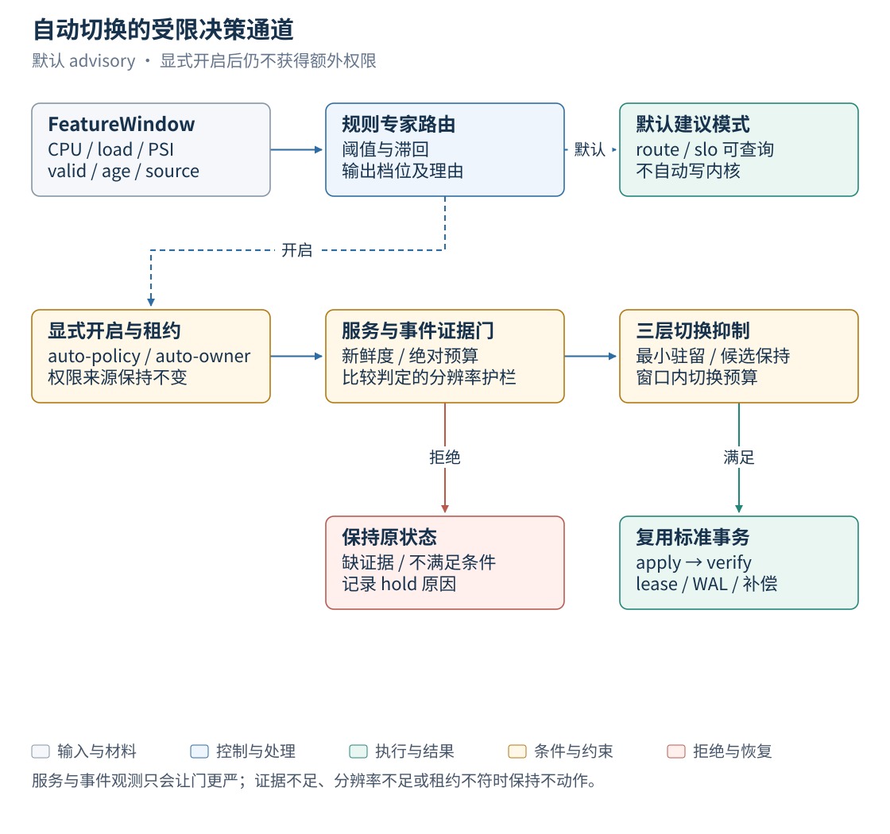
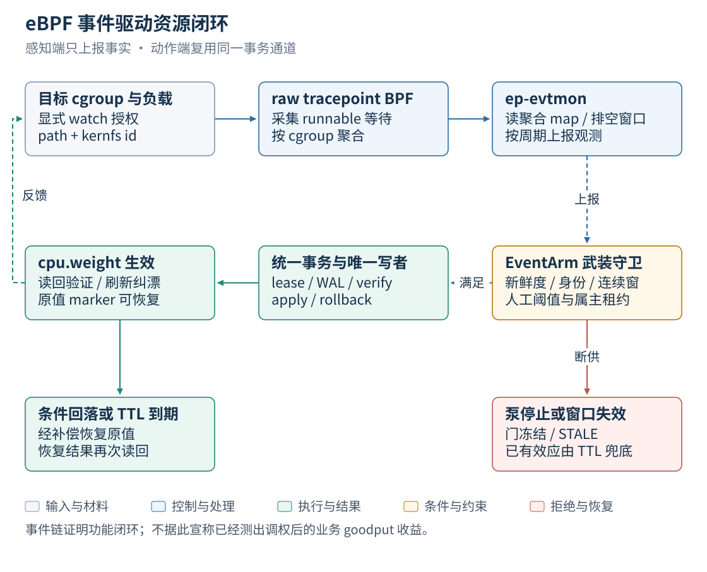
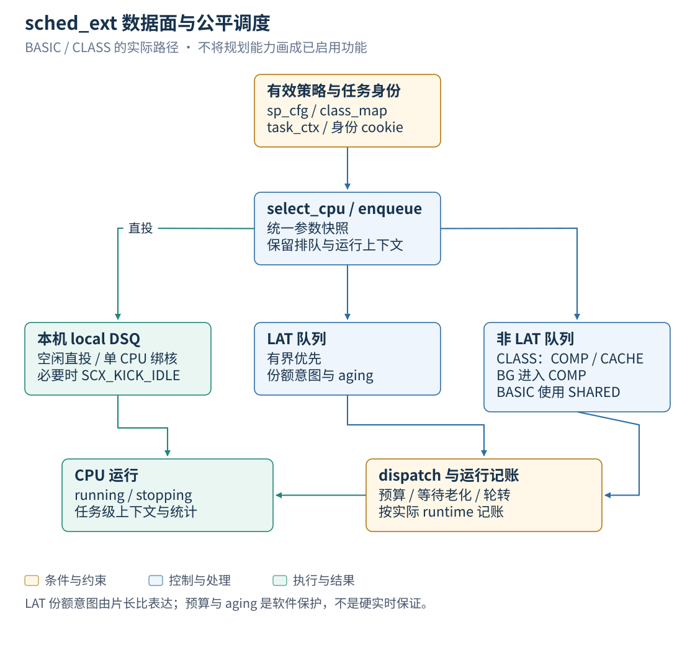
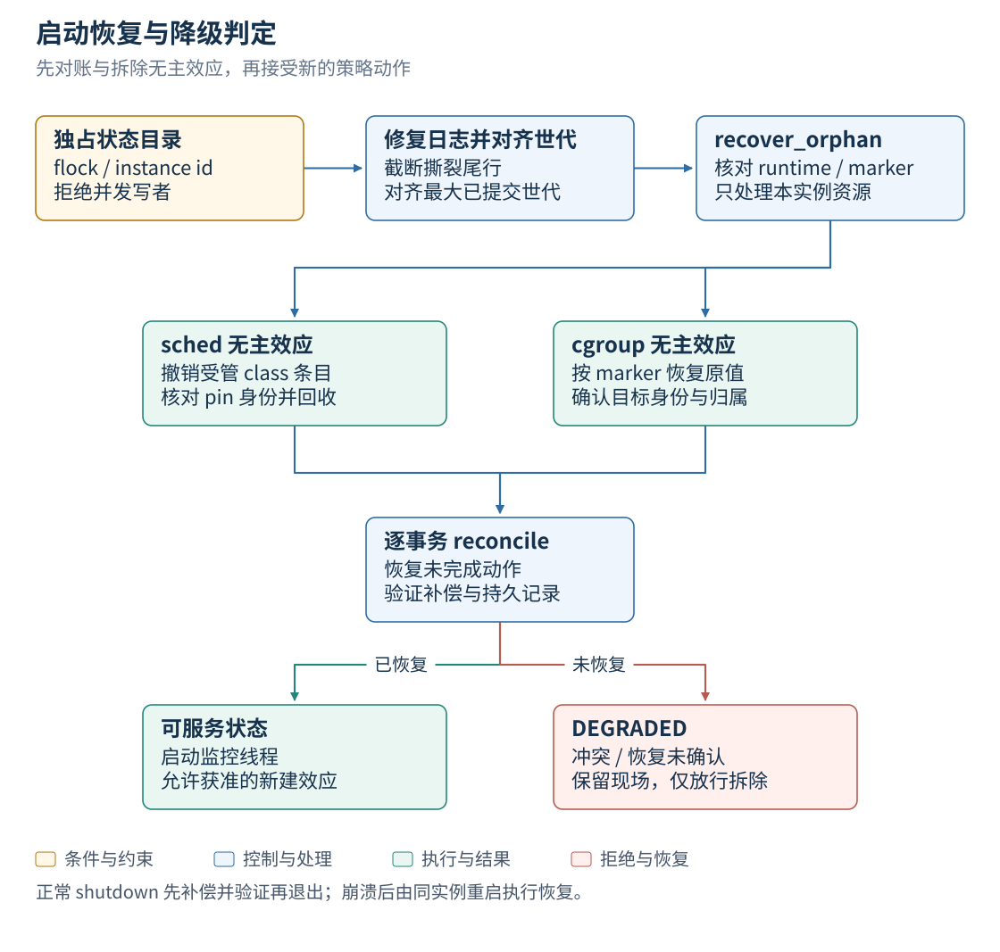

# EulerPilot v2 设计文档

| 文档名称 | EulerPilot v2 设计文档 |
|---|---|
| 文档版本 | v1.1 |
| 文档类型 | 设计文档 |
| 文档状态 | 正式发布 |
| 适用对象 | 评审专家、架构评审、接手开发的工程师 |
| 维护团队 | 三驱兄弟(西安邮电大学) |
| 验收系统 | openEuler 24.03 LTS-SP3,内核 `6.6.0-schedpilot-sp3` |
| 更新日期 | 2026-10-26 |
| 对应代码 | `src/`、`sched/`、`design/`(commit 级溯源见 `PROVENANCE.md`) |

> 本文件记录控制面的架构、模块、契约、关键流程与设计决策。设计总纲(含完整取舍
> 讨论)见 `docs/v2_redesign_2026.md`,接口契约见 `design/INTERFACES.md` 与
> `docs/p1/ABI_FREEZE.md`;本文是面向评审的浓缩版,结构与实现一一对应。

## 目录

1. [文档背景](#1-文档背景)
2. [设计目标与约束](#2-设计目标与约束)
3. [总体架构](#3-总体架构)
4. [模块设计](#4-模块设计)
5. [数据契约](#5-数据契约)
6. [关键流程时序](#6-关键流程时序)
7. [安全与权限模型](#7-安全与权限模型)
8. [设计决策记录](#8-设计决策记录)
9. [与参考工作的关系](#9-与参考工作的关系)
10. [修订记录](#10-修订记录)

## 1. 文档背景

EulerPilot v2 是面向 openEuler 的资源管控 Agent(赛题 proj2)。它要在真实的
sched_ext 内核上完成"感知 → 决策 → 执行 → 恢复"的闭环,同时保证任何软件故障都
不会把系统留在未知的调度状态里。实现一份策略容易,难的是让策略的每一次生效都可
验证、每一次失效都可恢复、每一次自动化都有边界。

本仓库为此重新设计了控制面:**策略全部声明式、写者唯一、变更全事务化、观测只能
收紧**。三个设计前判决定了后续所有取舍:

1. SP3 是唯一验收级系统(SP4 实测 cgroup v1 且无 PSI,只能记 UNSUPPORTED);
2. BG 是业务角色、LAT/COMPUTE/CACHE 是运行特征,两个维度正交,不得互相推断;
3. 自适应动作必须被租约、门控与抑制三层约束,自动化不获得额外权限。

表 1 本文与实现材料的对应关系

| 主题 | 本文位置 | 一手材料 |
|---|---|---|
| 分层与模块边界 | 第 3、4 章 | `src/`、`include/ep/` |
| 契约字段与取值 | 第 5 章 | `design/schemas/*.json`、`design/INTERFACES.md` |
| 事务与恢复语义 | 第 6 章 | `docs/p1/ABI_FREEZE.md`、`src/executor/` |
| 权限与自动化边界 | 第 7 章 | `src/core/`、`experiments/fail_safe_matrix_sp3.sh` |
| 决策与备选方案 | 第 8 章 | `docs/v2_redesign_2026.md`、`evidence/` |

## 2. 设计目标与约束

表 2 设计目标

| 编号 | 目标 | 验证方式 | 结果 |
|---|---|---|---|
| G1 | 策略生效与回退全事务,崩溃后可恢复 | fail-safe 矩阵 17 条目 | 17/17(run8 + 冻结构建 run9/10/11) |
| G2 | 内核状态自证(读回而非推断) | 集成测试断言 map/文件内容 | 8 项集成全过,0 SKIP |
| G3 | 自动化动作有三层边界(权限/证据/抑制) | 门控注入实验 + 单元门控矩阵 | 门控被量化为"延迟器"(约 40s) |
| G4 | 性能结论可复现 | 预注册矩阵 + 冻结二进制复跑 | 冻结构建复现 +1.83% [1.38, 2.26] |
| G5 | 扩展新资源域只需新 Skill,不动核心 | cgroup 域与事件链的实际接入 | 核心事务代码未因扩展而修改 |
| G6 | 失败可诊断、可追溯 | WAL + 逐轮哈希 + 逐请求原始件 | `PROVENANCE.md`、`evidence/` |

表 3 硬约束

| 约束 | 来源 | 对设计的影响 |
|---|---|---|
| 主验收系统为 openEuler 24.03-LTS-SP3 | 赛题要求 | 所有结论以 SP3 为准,其他系统只作参考 |
| Linux 同时只允许一个 sched_ext 调度器 | 内核行为(第二次 struct_ops 注册返回 EBUSY) | 与参考实现 `schedpilotd` 互斥运行;apply 前检查在位状态 |
| CPU 下线会注销当前调度器 | 内核行为(`hotplug_seq` 变化,`enable_seq` 不变) | 在位性判定不能只看计数器;S15 场景专门断言检出与补偿 |
| 内核在 `state` 可读之后才递增 `scx_enable_seq` | `kernel/sched/ext.c:5503–5518` | 采用等值判定 + 发布等待,否则误报 changed |
| 策略生成限于声明式白名单,不在线编译内核代码 | 安全边界 | 参数有界、专家档位枚举、BPF 对象预构建并哈希入档 |
| 内核多子系统之间不存在原子事务 | 系统现实 | 跨域变更按 saga 处理,补偿失败保留现场 |
| 测量存在窗间噪声 | 实测 p99 极差/均值 46% | 比较类判定先声明分辨率,不足则 `not run` |

## 3. 总体架构

### 3.1 逻辑分层与进程边界

*图 1　EulerPilot v2 总体架构*

图中虚线表示观测或持久化关系；特征窗、路由、门控、所有权和事务组件均在 `ep-executord` 进程内。每实例只选择 sched/cgroup 中的一个效果域。

### 3.2 架构规则

表 4 规则与执行机制

| 规则 | 机制 | 违反时的行为 |
|---|---|---|
| 外部调用者不直接写资源 | CLI/实验脚本/LLM 通道经 socket 提交策略；内置决策组件仍在执行服务进程内 | socket 0600 + peer uid；唯一执行服务负责效果写入 |
| 执行层互斥 | flock 状态目录 + 租约三态 + 世代号 | 第二实例拒绝启动;旧请求 `GENERATION_CONFLICT` |
| 数据层可验证 | 调度器在位性由 state/ops/enable_seq 联合判定;cgroup 一律读回;class 撤销用 `class-get` 确认 | 读回不符 → 补偿回退并 `VERIFY_FAILED` |
| kind 与实例域匹配 | apply 前按 `kind` 分派校验 | 不匹配零副作用 `REJECTED` + `UNSUPPORTED` |
| 观测只能收紧 | 门控只返回拒绝,放行由权限与证据决定 | 断供时拒绝动作并报告高水位 |
| 拆除优先于建立 | 存储不可写时授"仅内存租约" | 拆效应放行;建新效应 `RECOVERY_REQUIRED` |

### 3.3 模块依赖

表 5 依赖方向(自上而下,不存在反向依赖)

| 模块 | 依赖 | 被依赖 |
|---|---|---|
| `src/cli` | Unix socket 协议 | 用户/脚本 |
| `src/executor` | `src/core`、`src/skills` | — |
| `src/core` | 无特权系统调用只读 | `src/executor` |
| `src/skills` | `src/core`、`ep-schedctl`、loader、cgroup 文件系统 | `src/executor` |
| `src/evtmon` | BPF skeleton、`event.observe` | — |
| `sched/` | 内核 BTF、libbpf(静态) | `src/skills` |

## 4. 模块设计

### 4.1 CLI 客户端(`src/cli/main.cpp`)

10 个子命令,每个都建立一次性 AF_UNIX 连接、写一行 ND-JSON、读一行响应(1 MiB
上限),把响应以缩进 JSON 打印。退出码:`0` 仅当状态属于
`OK/VERIFIED/APPLIED/ROLLED_BACK`;其他为 `1`;参数错误为 `2`。

表 6 子命令与协议映射

| 命令 | 协议 op | 读写 |
|---|---|---|
| `ep status` | `policy.status` | 读 |
| `ep features` | `feature.snapshot` | 读 |
| `ep route` | `route.decide` | 读 |
| `ep slo --expert E` | `slo.evaluate` | 读 |
| `ep observe --file F` | `service.observe` | 摄取(不推进世代号) |
| `ep reconcile` | `transaction.reconcile` | 写 |
| `ep validate --file F` | `policy.validate` | 读 |
| `ep lease [--ttl-ms N] [--owner O]` | `lease.acquire` | 写 |
| `ep apply (--file\|--intent-file) [--idempotency-key K]` | `policy.apply` | 写 |
| `ep rollback --of … --transaction … --snapshot … --policy-sha256 …` | `policy.rollback` | 写 |

socket 路径解析顺序:`$EP_SOCKET` → `/run/eulerpilot-v2/executor/executor.sock` →
`$XDG_RUNTIME_DIR/eulerpilot-v2/executor/executor.sock` →
`/tmp/eulerpilot-v2-<uid>/executor.sock`。`apply`/`rollback` 会先自动取租约,再生成
信封(`req-*`/`txn-*` 随机标识、`issued_at=now`、`deadline=now+60000`)。

### 4.2 执行服务(`src/executor/`)

表 7 组件与职责

| 组件 | 文件 | 职责 |
|---|---|---|
| Ownership | `ownership.cpp` | flock、租约、fence、世代号持久化到 `state.json` |
| Journal | `journal.cpp` | 只追加 WAL,每次 append 后 fsync;启动时截断撕裂尾行 |
| 事务引擎 | `executor.cpp` | 校验、授权、快照、生效、验证、提交、补偿、幂等重放 |
| 监控线程 | `executor.cpp` | 50ms tick;1s 特征采样、1s 在位探测(连续 3 次失败才回退)、2s 刷新、2s 自动通道与事件守卫 |
| shutdown | `executor.cpp` | 收到停止信号先走同一条补偿回退(含 `verify_rolled_back`)再退出 |

事务状态机(日志类型):

*图 2　事务日志状态与恢复*

租约三态:无人持有 / 他人持有(拒绝动作)/ 自动通道持有(须显式交接)。世代号只在
`COMMITTED` 时推进,`REJECTED` 不推进(S08/S10/S17 均断言此点)。

### 4.3 核心逻辑(`src/core/`)

*图 3　自动切换的受限决策通道*

表 8 核心组件

| 组件 | 文件 | 要点 |
|---|---|---|
| 策略校验 | `policy.cpp` + `policy_json.hpp` | schema 之外的语义规则:切片关系、`heartbeat_timeout>period`、`policy_ttl>min_dwell`、`max_age≤heartbeat_timeout`、目标去重、`class=BG ⇔ role=BACKGROUND` |
| cgroup 策略校验 | `cgroup_policy.cpp` | effects 1–8、路径段拒绝 `.`/`..`、重复路径拒绝、TTL ≥10s |
| 目标绑定 | `target.cpp` | `O_PATH\|O_NOFOLLOW` FD + kernfs inode/cgroup_id;pidfd + starttime;退出/重建/迁出即失效 |
| 特征窗 | `features.cpp` | `cpu_busy_pct`/`load1`/`psi_cpu_some_avg10`,带 valid/age/来源;样本 ≥3 才算充分;`run_delay` 未采样 |
| 路由 | `router.cpp` | 阈值 + 5s 滞回,advisory 输出档位与理由 |
| SLO 门控 | `slo.cpp` | 服务半区 + 宿主半区 + 绝对上限 + 分辨率护栏;观测契约严格键校验与新鲜度判定 |
| AutoPilot | `autopilot.cpp` | 白名单专家 + 三层抑制(驻留/候选保持/预算) |
| 事件守卫 | `event_guard.cpp` | arm 解析、持续/回落连续窗计数、纯化判定函数 |
| 域与工具 | `domain.cpp`、`util.cpp` | 状态与错误码字符串、SHA-256、规范 JSON、RFC3339 |

### 4.4 调度 Skill(`src/skills/sched_skill.cpp` + `sched/`)

loader 进程完成 struct_ops 注册后,把 link fd 经 SCM_RIGHTS(带 CLOEXEC)交给执行
服务并退出;此后调度器生命周期归执行服务所有——执行服务崩溃即调度器分离,不留孤儿。

表 9 sched 域操作与自证

| 操作 | 实现 | 自证方式 |
|---|---|---|
| 挂载 | `ep-sched-loader --mode … --pin-dir … --fd-socket …` | `state`/`ops=eulerpilot`/`enable_seq` 三项等值判定(含发布等待) |
| 写 cfg | `ep-schedctl set`(短命子进程) | 写前快照、写后 `get` 读回 |
| 写 class | `ep-schedctl class-set --pid … --class …` | `class-get` 读回;NORMAL 不写条目 |
| 撤销 class | `class-del` | 再 `class-get` 确认不存在,否则记 `class revocation unconfirmed` |
| 漂移纠正 | 刷新周期 cfg 全量再断言;class 条目按轮换抽样 | 纠正时打印 `cfg drift corrected` / 抽样纠正日志 |
| 崩溃恢复 | 扫 pin 目录与 `sched-runtime.json` 的 `classified` 重建受管集合 | 孤儿条目撤销;外域资源不动并回报 conflict |

`--skill sched-ref` 是同接口的对照实现(loader 作为子进程常驻),用于证明 FD 传递路
径的差异不改变 fail-safe 语义(S05 使用它)。

### 4.5 cgroup Skill 与事件守卫(`src/skills/cgroup_skill.cpp`)

*图 4　eBPF 事件驱动资源闭环*

`cpu_weight → 内核写入值` 的翻译**只发生在 `plan()` 一处**,后续状态一律使用翻译后的
`desired`,避免两处口径不一致(该项曾在真机上把 0 写进内核)。写入必须
`O_WRONLY|O_TRUNC`:缺少 `O_TRUNC` 时把 `200` 改成 `50` 会读回 `500`。

表 10 cgroup 域不变量

| 不变量 | 保证手段 |
|---|---|
| 快照先于写入 | 读不到原值即 fail-closed,不进入 apply |
| marker 独立落盘 | `<state-dir>/cgroup-effects.json` 记录 path/file/previous/desired 与动作 ID |
| 效果不叠加 | 已有在位效应时第二次 apply 被拒 |
| 漂移可纠正 | 每刷新周期复查(文件读取代价低,可全量) |
| 崩溃可恢复 | 重启时按 marker 恢复原值并清理 marker,日志 `recovered N cgroup effect(s)` |
| 事件授权不转移 | watch 以 path + kernfs id 双匹配;重建即 `WATCH_REBUILT` 并回退 |

事件链数据通路:`events_trace.bpf.c`(raw tracepoint,按 cgroup kernfs id 聚合唤醒
等待,`start_time` 比对排除 PID 复用)→ `ep-evtmon`(只读泵,窗口排空 + id 解析回
路径 + `event.observe` 上报)→ `event_guard`(证据门与滞回)→ 标准 apply/rollback。
泵的开销与丢弃率已实测:0.5% 单核、12.1k 事件/s、pid 复用丢弃 0、聚合丢失 0
(`evidence/p4/pump-overhead-20261025.txt`)。

### 4.6 数据面(`sched/`)

*图 5　sched_ext 数据面与公平调度*

struct_ops 名 `eulerpilot`,接口版本 `SP_INTF_VERSION 3`,模式 basic/class/adaptive,
标志位 `CLASS_DSQ`/`PREEMPT`/`LLC_AFFINITY`/`BG_CONTAIN`/`CLASSIFY`。

表 11 map 清单

| map | 类型与容量 | 用途 |
|---|---|---|
| `sp_cfg` | ARRAY × 1 | 切片、抢占阈值、bg vtime、LAT 预算等运行参数 |
| `class_map` | HASH 16384 | tgid → 运行分类(LAT/COMPUTE/CACHE/BG) |
| `tg_stats` | HASH 32768 | 线程组统计 |
| `task_ctx` | TASK_STORAGE(`BPF_F_NO_PREALLOC`) | 任务级调度上下文 |
| `cpu_llc` | ARRAY 1024 | CPU → LLC 域映射 |
| `stats` | PERCPU_ARRAY(40 项) | 调度事件计数 |
| `pcpu_state` | PERCPU_ARRAY × 2 | 每 CPU 状态 |
| `fair_budget` | PERCPU_ARRAY | 与 CFS 的预算共存记账 |
| `wakeup_start` | HASH 65536(事件对象) | 唤醒时间戳暂存 |
| `wait_agg` | HASH 4096(事件对象) | 每 cgroup 等待聚合(上限 4096 个 cgroup) |
| `evt_stats` | ARRAY 4(事件对象) | 泵侧统计:追踪数、聚合数、丢弃数 |

表 12 关键参数(`intf.h` 默认值与边界)

| 参数 | 范围 | 默认 | 说明 |
|---|---|---|---|
| `lat_budget_pct` | 1–95 | 60 | LAT 份额意图;实际份额由片长比表达 |
| `budget_window_ms` | 10–10000 | 100 | 预算窗口 |
| `aging_ms` | 1–5000 | 20 | 等待老化,防饥饿 |
| `SP_HEARTBEAT_TIMEOUT_NS` | 固定 2e9 | — | 仅 adaptive 路径读取(v2 不启用 adaptive) |

数据面两处关键修复来自真机根因分析:绑核任务(`nr_cpus_allowed==1`)直投本机
local DSQ 并 `SCX_KICK_IDLE`(修复前 6/6 触发 runnable task stall,修复后 3×90s 零
失速);LAT 份额按 `lat_slice = comp_slice × pct / (100 − pct)` 换算(60% 预算实测
57.9–58.5%)。

## 5. 数据契约

所有契约位于 `design/schemas/`,JSON Schema Draft-07、`additionalProperties:false`;
示例位于 `design/examples/`。设计自检 `scripts/validate_design.py` 强制 6 个正例通过、
27 个反例被拒。

表 13 契约清单

| 契约 | kind | 必填/关键约束 |
|---|---|---|
| `scheduling-policy.schema.json` | `SchedulingPolicy` | `spec` 需 scope/mode/expert/source/targets/parameters/safety;targets 1–64;安全字段全部必填 |
| `cgroup-policy.schema.json` | `CgroupPolicy` | `scope=cgroup-effects`;effects 1–8;`cpu_weight` 1–10000;`policy_ttl_ms` 10000–3600000 |
| `event-arm.schema.json` | `EventArm` | `watch`;`threshold_wait_ms` 1–60000;sustain/release 1–10;`action.cpu_weight` |
| `action-envelope.schema.json` | — | 11 个必填字段;`operation` ∈ policy.apply/policy.rollback;`policy_sha256` 64 位小写十六进制;回滚必须带 `rollback_of` |
| `skill-manifest.schema.json` | `SkillManifest` | 能力与生命周期声明;`execution=privileged-executor-only`;apply 必须伴随 snapshot/verify/rollback/reconcile |

表 14 协议 op 与消息要点

| op | 是否需要信封 | 要点 |
|---|---|---|
| `policy.status` / `feature.snapshot` / `route.decide` | 否 | 只读,响应 `status:"OK"` |
| `slo.evaluate` | 否 | 入参 `expert`,可选 `max_observation_age_ms` |
| `service.observe` / `event.observe` | 否 | 严格键集校验;观测过旧(>600s 或 >10×窗口)或未来(>5s)拒绝 |
| `lease.acquire` | 否 | `lease_owner` 8–128(缺省 `agent-<hex6>`)、`lease_ttl_ms ≥1000` |
| `policy.validate` | 否 | dry-run:校验 + 目标解析 + 摘要 |
| `policy.apply` / `policy.rollback` / `transaction.reconcile` | 是 | 信封 11 字段齐备,`apiVersion` 必须等于 `eulerpilot.io/v1alpha1`,`deadline > issued_at` |

表 15 响应状态与错误码

| 类别 | 取值 |
|---|---|
| 状态 | `OK`(只读成功)、`VERIFIED`、`REJECTED`、`ROLLED_BACK`、`DEGRADED`、`RECOVERY_REQUIRED` |
| 错误码 | `SCHEMA_INVALID`、`UNSUPPORTED`、`PERMISSION_DENIED`、`TARGET_STALE`、`OWNERSHIP_CONFLICT`、`GENERATION_CONFLICT`、`DEADLINE_EXCEEDED`、`SLO_DENIED`、`APPLY_FAILED`、`VERIFY_FAILED`、`ROLLBACK_FAILED`、`RECOVERY_REQUIRED`、`IDEMPOTENCY_CONFLICT`、`INTERNAL` |

契约演进规则:字段变更必须同步 schema、示例、校验脚本与文档四处;`ABI_FREEZE.md`
冻结的字段语义不得静默改变,新增可选字段需在 P1 报告登记(如
`lease_persisted`、`store_warning`)。

## 6. 关键流程时序

### 6.1 策略生效(policy.apply)

*图 6　策略生效与补偿流程*

### 6.2 事件守卫(监控线程,2s 周期)

*图 7　事件守卫的判定与动作*

### 6.3 崩溃恢复(重启)

*图 8　启动恢复与降级判定*

停止路径与崩溃路径不同:`shutdown()` 先执行一次完整补偿回退(含 `verify_rolled_back`)
再清理 pid 与 socket,因此正常停止不会留下 pin(run2 曾泄漏 5 个 map pin,已修复)。

## 7. 安全与权限模型

表 16 权限层次

| 层 | 持有 | 边界 |
|---|---|---|
| 外部调用与内置决策 | 外部客户端无直接资源写接口；内置路由/门控与执行服务同进程 | 观测摄取不推进世代号；`source=llm-proposal` 必须过门控；逻辑分层不构成进程权限隔离 |
| 执行层 | BPF/cgroup 写权限 | socket 0600 + `SO_PEERCRED` 同 uid 限定(仅 `--allow-any-uid` 放宽);每连接 5s 接收超时 |
| 数据层 | 内核 | 所有写入读回自证;link FD 随进程死亡失效 |

表 17 自动化边界三例

| 自动化通道 | 开启方式 | 权限来源 | 失败时的默认 |
|---|---|---|---|
| AutoPilot 专家切换 | `--auto-apply --auto-policy F --auto-owner ID` | 必须由该属主持有租约 | 不动作 |
| 事件驱动调权 | `--skill cgroup --event-arm arm.json` | arm 属主租约 + 新鲜观测 + 人工阈值授权 | 门冻结 |
| 策略 TTL | 策略内 `policy_ttl_ms` | 声明即上限 | 到期自动回退 |

其他安全要点:目标路径解析防符号链接(`O_NOFOLLOW`)与越权;schema 正则不替代文件
描述符与内核身份验证;租约与 fence 防止过期凭证覆盖新状态;`RECOVERY_REQUIRED` 期间
拒绝一切新建效应,只放行拆除。

## 8. 设计决策记录

表 18 决策记录(按时间)

| 决策 | 备选 | 选择理由与证据 |
|---|---|---|
| 唯一特权写者 + 声明式契约 | 各组件直写内核 | 第二写者在结构上不可构造;负路径矩阵 S08–S11 验证 |
| link FD 经 SCM_RIGHTS 移交后 loader 退出 | loader 常驻 | 执行服务崩溃即调度器分离,不留孤儿;`integration_fd` |
| `enable_seq` 等值判定 + 发布等待 | 计数器递增即信任 | 内核在 state 可读之后才递增(`kernel/sched/ext.c:5503–5518`);曾致 7 次验收败 2 |
| 绑核任务直投本机 local DSQ + `SCX_KICK_IDLE` | 唤醒 idle CPU 等拉取 | 6.6 内核把不允许的拉取改投全局 DSQ;修复前 6/6 失败 → 3×90s 零失速 |
| LAT 份额用片长比表达 | 直接写百分比 | 份额由片长比决定;60% 预算实测 57.9–58.5% |
| BG 与运行特征正交 | 按 CPU 占用推断角色 | 业务角色须显式授权;`class=BG ⇔ role=BACKGROUND` 为校验不变量 |
| 观测只能收紧 | 观测可放行 | 噪声与断供两种失败模式下,放行会把误报变成动作 |
| 比较类判定声明分辨率 | 直接判 | 同状态 p99 窗间噪声 46% ≫ 声明预算 5% |
| 失效方向不对称(拆放行/建拒绝) | 写失败一律拒绝 | 盘满时仍能安全回退;S14 与 `ABI_FREEZE.md` §6 第 8 条 |
| class 撤销必须读回确认 | 只看 `cfg.flags` | 协议 §8 要求检查旧 class/vtime/slice;`class revocation unconfirmed` 日志 |
| class 逐条漂移按轮换抽样纠正 | 全量再断言 / 不纠正 | 全量读回在 16k 条目下不可负担;抽样 + cfg 全量的组合成本实测约 5ms/次 |
| 泵死亡 = 门冻结 | 忽略断供 | 断供后世界状态未知;冻结 + TTL 兜底保持安全侧 |
| 跨域失败按 saga 处理 | 承诺原子事务 | 内核子系统间无原子性;补偿失败保留现场并 `RECOVERY_REQUIRED` |
| 事件链动作复用标准事务路径 | 泵直接写 cgroup | 保持唯一写者;`integration_events` 第六相亲测泵零写入 |

## 9. 与参考工作的关系

表 19 来源与边界

| 来源 | 复用内容 | 本项目新增 | 许可与溯源 |
|---|---|---|---|
| SchedPilot(前作) | BPF 数据面骨架与实验方法(`sched/`,源提交 `0aeca0c`) | 控制面、执行服务、CLI、事件链、恢复语义 | GPL-2.0;逐文件哈希见 `sched/README.md`、`PROVENANCE.md` |
| EulerPilot(v1) | Skill 与审计思路 | 代码未复用;契约、租约/世代号、WAL、fail-safe 全部重写 | 见 `docs/audits/` 审计记录 |
| 上游 sched_ext | 内核框架与 `scx` 头文件 | 自建调度器 `eulerpilot` 与 loader | 内核头文件随源码归档 |
| 公开文献(Towards Agentic OS、MoS/ASA) | 专家路由、SLO 门控思想 | 增量在约束链、发布一致性与实测闭环 | 一手链接核验见 `docs/research/sources.md` |
| 参考实现 `schedpilotd` | 作为 E 臂对照(互斥运行) | 新旧控制面一致性验证(GET +1.92% vs 本项目 C +1.83%) | `evidence/p2/earms-20261025.txt` |

**归属纪律**:思想来源与代码来源分别标注;凡派生文件记录源版本与哈希;性能对照
显式说明互斥运行条件;公开化历史(如镜像分支的历史重写)在 `PROVENANCE.md` 披露。

## 10. 修订记录

| 版本 | 日期 | 内容 | 作者 |
|---|---|---|---|
| v1.0 | 2026-10-25 | 随交付创建 | 三驱兄弟 |
| v1.1 | 2026-10-25 | 扩充:模块增至六个(CLI/执行服务/核心/调度 Skill/cgroup 与事件/数据面)、依赖表、map 与参数表、协议 op 与错误码表、三处时序补全、决策记录增至 14 条并附证据 | 三驱兄弟 |
| v1.1 图示修订 | 2026-10-26 | 补充 SVG 架构、流程与验证示意图及可编辑源文件；图示按当前实现标注边界，性能数据口径不变 | 三驱兄弟 |
